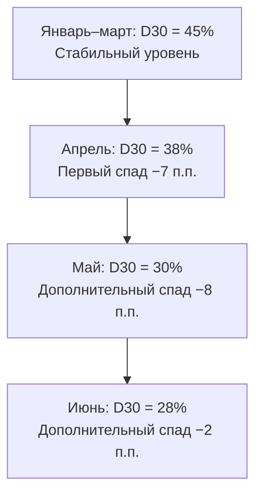
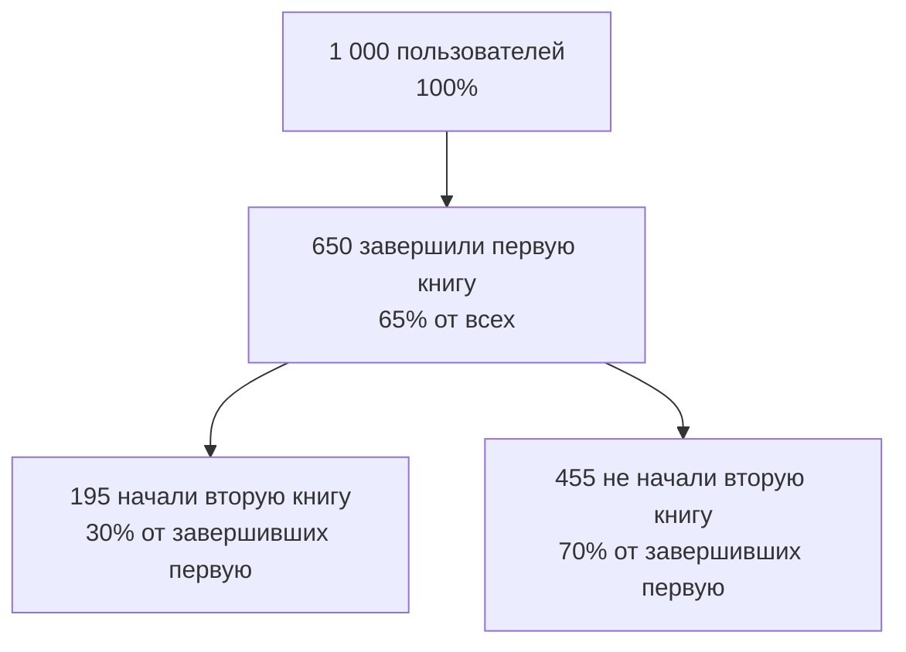
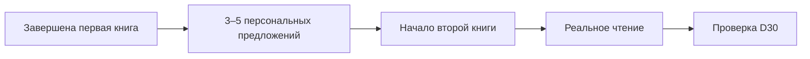

# BookLover: анализ удержания пользователей и стратегия снижения оттока

> **Кейс:** мобильное приложение для чтения книг BookLover  
> **Тема:** Retention Rate, когортный анализ и продуктовые эксперименты  
> **Дата подготовки:** 23 октября 2026 года  
> **Основа анализа:** исходные данные учебного кейса и опубликованные научные исследования

## Краткое резюме

**Вывод:** BookLover привлекает всё больше пользователей, но удерживает всё меньшую их долю. Retention через 30 дней после регистрации снизился с **45%** в январе–марте до **28%** в июне: **−17 процентных пунктов** (или **−37,8%** относительно исходного уровня). Перелом начался в **апреле**.

**Рекомендуемая стратегия:** сначала проверить причины падения по источникам привлечения, версиям приложения и поведению пользователей; затем тестировать (1) исправления выявленных проблем качества, (2) персональные рекомендации следующей книги и (3) добровольные сценарии регулярного чтения. Успех оценивать по **D30 Retention и реальному чтению**, а не только по кликам и открытиям приложения.

**Принципиальное ограничение:** кейс показывает *факт снижения удержания*, но не содержит данных, позволяющих доказать его причину. Все объяснения и меры ниже — проверяемые гипотезы, а не установленные причины.

---

## Содержание

1. [Исходные данные и определения](#1-исходные-данные-и-определения)
2. [Расчёт Retention Rate D30](#2-расчёт-retention-rate-d30)
3. [Момент начала существенного снижения](#3-момент-начала-существенного-снижения)
4. [Диагностика возможных причин](#4-диагностика-возможных-причин)
5. [Научные исследования и их применимость](#5-научные-исследования-и-их-применимость)
6. [Три приоритетные продуктовые гипотезы](#6-три-приоритетные-продуктовые-гипотезы)
7. [Метрики и план измерений](#7-метрики-и-план-измерений)
8. [Метод проверки: эксперименты и аналитика](#8-метод-проверки-эксперименты-и-аналитика)
9. [Количественная оценка потерь и возможного эффекта](#9-количественная-оценка-потерь-и-возможного-эффекта)
10. [Итоговые ответы на пять вопросов кейса](#10-итоговые-ответы-на-пять-вопросов-кейса)
11. [Ограничения и научные источники](#11-ограничения-и-научные-источники)

---

## 1. Исходные данные и определения

BookLover запущен шесть месяцев назад. Новые регистрации растут, однако доля пользователей, активных через 30 дней после регистрации, снижается.

| Месяц регистрации | Новые пользователи | Активны через 30 дней | Средняя оценка приложения за период |
|---|---:|---:|---:|
| Январь | 12 000 | 5 400 | 4,5/5 (январь–март) |
| Февраль | 15 000 | 6 750 | 4,5/5 (январь–март) |
| Март | 18 000 | 8 100 | 4,5/5 (январь–март) |
| Апрель | 22 000 | 8 360 | 4,2/5 (апрель–июнь) |
| Май | 25 000 | 7 500 | 4,2/5 (апрель–июнь) |
| Июнь | 27 000 | 7 560 | 4,2/5 (апрель–июнь) |

Поведенческие показатели, данные в условии:

- **65%** пользователей завершили чтение хотя бы одной книги.
- **30%** начали вторую книгу после завершения первой.

### Что именно измеряется

**Когорта** — пользователи, зарегистрировавшиеся в один и тот же период (например, в апреле).

**D30 Retention** — доля пользователей когорты, активных через 30 дней после регистрации. В этом кейсе используются готовые значения «активны через 30 дней». До внедрения продуктовой аналитики необходимо уточнить, означает ли это активность *строго на 30-й день* либо активность *в пределах окна*; эти определения нельзя смешивать.

**Процентный пункт (п.п.)** — разница между двумя процентами: снижение с 45% до 38% составляет **7 п.п.**, а не 7% в относительном выражении.

## 2. Расчёт Retention Rate D30

Формула:

\[
\operatorname{Retention\ Rate\ D30} = \frac{\text{Активные пользователи когорты через 30 дней}}{\text{Все зарегистрированные пользователи когорты}} \times 100\%.
\]

**Пример для апреля:**

\[
\frac{8\,360}{22\,000} \times 100\% = 38\%.
\]

### Итоговый когортный расчёт

| Месяц | Новые пользователи | Активны на D30 | Retention D30 | Изменение к предыдущему месяцу |
|---|---:|---:|---:|---:|
| Январь | 12 000 | 5 400 | **45%** | — |
| Февраль | 15 000 | 6 750 | **45%** | 0 п.п. |
| Март | 18 000 | 8 100 | **45%** | 0 п.п. |
| Апрель | 22 000 | 8 360 | **38%** | −7 п.п. |
| Май | 25 000 | 7 500 | **30%** | −8 п.п. |
| Июнь | 27 000 | 7 560 | **28%** | −2 п.п. |

### Наглядная динамика

```text
Retention D30
Январь   45% | █████████████████████████████████████████████
Февраль  45% | █████████████████████████████████████████████
Март     45% | █████████████████████████████████████████████
Апрель   38% | ██████████████████████████████████████
Май      30% | ██████████████████████████████
Июнь     28% | ████████████████████████████
                Каждая █ ≈ 1 процентный пункт
```

Проверочные показатели:

- Первоначальный уровень (январь–март): **45%**.
- Последний уровень (июнь): **28%**.
- Абсолютное изменение: **28% − 45% = −17 п.п.**
- Относительное изменение: **(28 / 45 − 1) × 100% = −37,8%**.
- Совокупный взвешенный D30 для январских–мартовских когорт: **45%** (20 250 / 45 000).
- Совокупный взвешенный D30 для апрельских–июньских когорт: **31,65%** (23 420 / 74 000).

**Важно:** число активных пользователей в когорте через 30 дней — это *не то же самое*, что общее число ежемесячно активных пользователей приложения (MAU). Для оценки MAU нужны отдельные данные.

## 3. Момент начала существенного снижения

**Первый выраженный спад — апрель:** показатель уменьшился с 45% до 38% (**−7 п.п.**). В мае снижение ускорилось до 30% (**ещё −8 п.п.**), а в июне достигло 28%.



Характерный пример: **в июне привлекли 27 000 новых пользователей — на 50% больше, чем в марте (18 000), — но на D30 осталось 7 560 против мартовских 8 100**, то есть удержанных пользователей стало на **540 человек (−6,7%) меньше**.

**Интерпретация:** объём привлечения увеличивается, но превращается в активную аудиторию заметно менее эффективно. Это ещё не доказывает, что качество продукта ухудшилось: альтернативная причина — изменение состава привлекаемых пользователей.

## 4. Диагностика возможных причин

### 4.1. Переход от первой книги ко второй

По условию 65% пользователей завершили хотя бы одну книгу, а 30% начали вторую после первой. Не указан знаменатель показателя 30%: далее используется **предположение**, что это доля *среди завершивших первую книгу*.

Тогда для условных 1 000 пользователей:



При таком прочтении **19,5% всех пользователей** начали вторую книгу (65% × 30%). Это *условный расчёт*, а не точно установленный результат кейса.

Возможная продуктовая проблема: пользователь завершает книгу и не получает подходящего, убедительного повода продолжить чтение. Однако показатель перехода может отражать и объективную длительность чтения, перерывы между книгами и состав аудитории. Без даты и определения событий нельзя связывать эти 30% напрямую с падением D30.

### 4.2. Четыре группы объяснений

| Возможная причина | Сигнал из кейса | Что проверить |
|---|---|---|
| **Качество приложения ухудшилось** | Средняя оценка снизилась с 4,5 до 4,2 | Изменения интерфейса, даты релизов, ошибки чтения, скорость открытия книги, жалобы по версиям |
| **Слабый переход ко второй книге** | Только 30% начали вторую после завершения первой | Показ рекомендаций, релевантность, старт следующей книги, её фактическое чтение |
| **Изменился состав аудитории** | Новые регистрации выросли с 12 до 27 тыс./мес. | D30 по рекламным каналам, кампаниям, типам пользователей и странам/регионам |
| **Чтение не стало регулярным действием** | Падает D30, но частота чтения неизвестна | Количество дней чтения, перерывы между сессиями, повторные открытия книги |

### 4.3. Главная аналитическая развилка

Прежде чем менять продукт, необходимо разделить два сценария:

1. **D30 падает внутри сопоставимых сегментов** (тот же канал, платформа, версия, сходный профиль пользователей). Тогда возрастает вероятность проблемы пользовательского опыта или соответствия контента потребностям.
2. **D30 падает только в общей агрегированной метрике**, потому что выросла доля низкоудерживаемого рекламного трафика. Тогда первоочередное действие — оптимизация привлечения, а не массовая переработка приложения.

Сравнивать нужно пользователей с одинаковым сроком наблюдения; иначе когортный вывод окажется искажённым.

## 5. Научные исследования и их применимость

Ниже — исследования, которые помогают формировать и критически оценивать гипотезы. Их результаты **не являются экспериментами на BookLover**.

| Исследование | Что установлено | Практический вывод для BookLover | Ограничение применимости |
|---|---|---|---|
| **Zhao Xia и соавт., 2023 — *Understanding of the Dynamics of Mobile Reading*** | Анализ действий пользователей мобильного приложения чтения связал длительность загрузки контента, предыдущую частоту чтения и динамику вовлечённости; активно читающие пользователи особенно чувствительны к задержкам | Измерять время загрузки, ошибки и реальную частоту чтения | Модельное исследование поведения, а не эксперимент по улучшению BookLover |
| **NBER, 2026 — *The Economics of Algorithmic Personalization*** | В эксперименте с 7 750 учащимися персонализация одного раздела образовательного приложения повысила вовлечённость в приложении в целом на 14% | Проверить персональные рекомендации контента в A/B-тесте | Другое приложение, другая аудитория; вовлечённость ≠ D30 Retention |
| **Bell и соавт., 2023 — *How Notifications Affect Engagement With a Behavior Change App*** | Уведомления увеличивали вероятность открытия приложения в последующий час примерно в 3,5 раза, но не дали статистически значимого различия по времени до прекращения использования между исследованными политиками | Не принимать количество открытий по push за доказательство снижения оттока | Изучалось приложение изменения поведения, не чтение книг |
| **Long и соавт., 2024 — *The Choice Overload Effect in Online Recommender Systems*** | Полевой эксперимент с 1,6 млн потребителей выявил немонотонный эффект количества рекомендаций: избыток вариантов мог снижать вероятность покупки | Тестировать компактный, релевантный список, а не десятки рекомендаций | Электронная коммерция; эффект на начало следующей книги нужно проверить отдельно |
| **Gu и соавт., 2022 — *Measuring the Impact of Crowdsourcing Features on Mobile App User Engagement and Retention*** | Рандомизированный эксперимент в мобильной игре показал, что отдельные функции пользовательского участия могут увеличивать удержание, но совместный эффект функций бывает отрицательным | Не предполагать, что добавление большего числа функций автоматически улучшит удержание | Исследование игрового приложения, а не электронной библиотеки |

### Контраргументы, которые нельзя игнорировать

- **Персонализация может увеличить клики, но не D30.** Нужно измерять чтение после рекомендации и долгосрочное возвращение.
- **Push-уведомления могут вызывать открытия, но не привычку.** Возможны раздражение и отключение уведомлений.
- **Рост выбора может мешать выбору.** Число рекомендаций — параметр эксперимента, а не самостоятельная цель.
- **Снижение оценки не доказывает технический дефект.** Оценка может меняться из-за новых ожиданий аудитории, другого содержания каталога или особенностей выборки отзывов.

Вывод научной части: исследования поддерживают *проверку* трёх предложенных направлений, но выбор конкретного решения должен опираться на собственные данные и причинно обоснованные эксперименты BookLover.

## 6. Три приоритетные продуктовые гипотезы

### Гипотеза №1. Устранение ухудшений в опыте чтения

**Формулировка:** если падение удержания связано с техническими или интерфейсными проблемами, их устранение увеличит число успешных читательских сессий и D30 Retention.

**Основание:** одновременно с падением удержания снизилась средняя оценка приложения с 4,5 до 4,2. Это косвенный сигнал, а не доказательство.

**Возможные изменения:**

- устранить критические ошибки открытия книг и перелистывания страниц;
- сократить время загрузки книг и глав;
- обеспечить надёжное сохранение прогресса чтения;
- упростить возврат к последней странице и библиотеке.

**Проверка:** сопоставить изменения D30 и технических метрик по версиям приложения и устройствам; подтвердить проблемный релиз или функцию, исправить выявленные дефекты, затем измерить эффект по сопоставимым сегментам.

**Основная метрика:** D30 Retention по версиям и затронутым сегментам.  
**Диагностические метрики:** crash-free sessions/users, p95 открытия книги, ошибка загрузки, успешные старты чтения.  
**Ограничение:** нельзя намеренно оставлять критический дефект группе пользователей только ради A/B-теста.

### Гипотеза №2. Рекомендации следующей книги

**Формулировка:** если сразу после завершения первой книги показать короткий список релевантных книг с возможностью начать чтение, больше пользователей перейдут ко второй книге, что может повысить D30 Retention.

**Основание:** по условию только 30% начали вторую книгу после завершения первой (точная база нуждается в проверке).

**Предлагаемая механика:**

1. Пользователь завершает первую книгу.
2. BookLover показывает **3–5 рекомендаций**, исходя из жанров, истории чтения и явно указанных интересов.
3. Пользователь может открыть фрагмент, начать следующую книгу или сохранить её.
4. Система оценивает не только выбор рекомендации, но и фактическое чтение новой книги.



**A/B-тест:** среди пользователей, завершивших первую книгу, случайным образом сформировать две группы:

- **A (контроль):** обычный экран завершения;
- **B (тест):** экран с персональными рекомендациями.

**Основная метрика результата:** D30 Retention в заранее определённой экспериментальной популяции.  
**Промежуточная метрика:** доля начавших вторую книгу за 7 дней после завершения первой.  
**Защитные метрики:** разнообразие выбираемого контента, жалобы, снижение времени чтения.

**Успех:** пользователи в тестовой группе статистически и практически значимо чаще продолжают читать и демонстрируют лучший D30. Рост только кликов — недостаточен.

### Гипотеза №3. Поддержка регулярной привычки чтения

**Формулировка:** если пользователь сможет добровольно выбрать небольшую цель чтения и легко продолжать незавершённую книгу, он будет чаще возвращаться к реальному чтению и реже прекращать использование.

**Предлагаемая механика:**

- необязательная ежедневная цель (например, 10–15 минут);
- продолжение чтения с сохранённой страницы в один шаг;
- мягкие контекстные напоминания в выбранное время;
- видимый прогресс без наказаний за пропущенный день;
- возможность отключить уведомления или изменить их частоту.

**A/B-тест:** контроль получает текущий сценарий; тест — возможность выбрать цель и контекстные напоминания. Проверять эффект в общей заранее выбранной группе и отдельно среди давших согласие на уведомления.

**Основная метрика:** D30 Retention.  
**Промежуточные:** число дней с чтением в неделю, повторные сессии, время до возвращения к незавершённой книге.  
**Защитные:** отключения уведомлений, удаление приложения, жалобы на навязчивость.

**Успех:** растёт частота содержательного чтения и D30, а раздражение от напоминаний не увеличивается.

### Сравнение гипотез

| Гипотеза | Потенциал | Что известно о причине в BookLover | Решение по приоритету |
|---|---|---|---|
| №1. Качество чтения | Высокий, если найден дефект | Только косвенный сигнал — снижение рейтинга | **Первая диагностика**, затем исправление подтверждённых проблем |
| №2. Следующая книга | Высокий для завершивших первую книгу | Есть сигнал слабого перехода, но не доказана связь с D30 | **Первый приоритет для продуктового A/B-теста** |
| №3. Регулярное чтение | Зависит от характера аудитории | Недостаточно данных о частоте использования | **Следующий эксперимент** после диагностики |

## 7. Метрики и план измерений

### 7.1. Основная метрика результата

**D30 Retention** — общая метрика принятия решения. Дополнительно использовать **D1, D7, D14 и D60**, чтобы установить, когда возникает отток и сохраняется ли эффект после 30-го дня.

Важно **сохранить исходное определение D30** для сравнения с историей. Если текущая «активность» означает просто открытие приложения, отдельной метрикой следует ввести **D30 Meaningful Reading Retention** — чтение содержимого на 30-й день (порог реального чтения необходимо заранее определить и проверить).

### 7.2. Метрики по гипотезам

| Гипотеза | Итоговая метрика | Метрики механизма | Защитные метрики |
|---|---|---|---|
| №1. Качество | D30 по версиям/устройствам | p95 времени открытия книги, частота ошибок, доля успешных сессий чтения | Новые сбои, жалобы, снижение оценки |
| №2. Рекомендации | D30 среди заранее заданной экспериментальной популяции | Старт второй книги за 7 дней, глубина и время её чтения | Нерелевантные рекомендации, сокращение разнообразия |
| №3. Привычка | D30 новых пользователей | Дни чтения в неделю, возврат к книге, D7 | Отключение уведомлений, отписки, удаления приложения |

### 7.3. Минимальный набор событий аналитики

| Событие | Назначение |
|---|---|
| `registration` | Дата включения пользователя в когорту |
| `app_open` | Сопоставимость с существующей активностью, если она основана на входах |
| `book_opened` | Начало взаимодействия с конкретной книгой |
| `reading_session` | Факт и длительность содержательного чтения |
| `book_completed` | Завершение книги |
| `recommendation_shown` | Фактический показ предложения |
| `recommendation_clicked` | Отклик на рекомендацию |
| `second_book_started` | Переход ко второй книге после первой |
| `notification_sent` / `notification_opened` | Доставка и отклик на сообщение |
| `app_error` | Технические сбои, влияющие на сценарий |

Минимальные свойства событий: `user_id`, `timestamp`, `registration_cohort`, `app_version`, `platform`, `acquisition_source`; для книжных событий — `book_id`, при наличии — `genre`, `session_duration`. Соблюдать требования защиты персональных данных и минимизации собираемой информации.

### 7.4. Рабочая карта KPI

| KPI | Текущее значение по кейсу | Ориентир | Интерпретация |
|---|---:|---:|---|
| D30 Retention | **28%** (июнь) | **32%** — начальная экспериментальная цель | Цель задаётся для управления, не является прогнозом |
| D30 Retention | Исторически **45%** (январь–март) | **38%**, затем **45%** | Контрольные уровни восстановления |
| Завершение хотя бы одной книги | **65%** | Пока без числовой цели | Неизвестно временное окно |
| Старт второй книги | **30%** | Рост относительно контроля | Требуется точный знаменатель |
| Оценка приложения | **4,2/5** (апрель–июнь) | Восстановление без ухудшения иных KPI | Косвенная мера качества |

## 8. Метод проверки: эксперименты и аналитика

### 8.1. Последовательность работ

1. **Проверить зрелость данных.** Убедиться, что для каждой когорты прошёл полный 30-дневный период наблюдения. Например, показатель для июньской когорты нельзя полностью посчитать до соответствующих дат июля.
2. **Уточнить определения.** Активность, завершение книги, начало второй книги, временные окна, знаменатели и правила дедупликации пользователей.
3. **Разложить удержание по сегментам.** Источник привлечения, рекламная кампания, версия приложения, ОС, жанр первой книги, действия в первую неделю.
4. **Проверить историю продукта.** Релизы, изменения каталога, цены/подписки, paywall, сбои и обращения в поддержку вблизи апрельского перелома.
5. **Исправить доказанные критические дефекты.** Не задерживать исправления ради эксперимента.
6. **Провести A/B-тесты гипотез №2 и №3.** Рандомизация, непересекающиеся условия тестов или корректный факторный дизайн, заранее определённые метрики.
7. **Дождаться D30 и оценить результат.** Не объявлять победу на основании D1, открытия push или промежуточной конверсии.
8. **Масштабировать только подтверждённые решения.** Проверить устойчивость эффекта и отрицательные побочные последствия.

### 8.2. Требования к корректному A/B-тесту

- Определить **основную метрику и минимально полезный эффект до запуска**.
- Рандомизировать пользователей, а не отдельные просмотры, если эффект оценивается на уровне пользователя.
- Использовать одинаковые определения событий и периодов для теста и контроля.
- Рассчитать объём выборки с учётом базового значения, мощности, уровня значимости и фактического охвата функции.
- Не делать вывод по «победившему» варианту до завершения заранее установленного периода; контролировать множественные сравнения.
- Оценивать не только общий результат, но и заранее определённые сегменты, избегая случайной подгонки под результат.

### 8.3. Условный пример результата эксперимента

Предположим, контроль имеет D30 = **28%**, а тест — **32%**.

- Абсолютный эффект: **+4 п.п.**
- Относительный эффект: **(32 / 28 − 1) × 100% ≈ +14,3%**.
- При условном распространении такого эффекта на **27 000** новых пользователей: **27 000 × 0,04 = 1 080** дополнительных пользователей на D30.

Это **иллюстрация**, не обнаруженный эффект. Для выявления изменения 28% → 32% в простом двухгрупповом тесте при α = 0,05, мощности 80% и равных группах понадобится **приблизительно 2,1 тыс. пользователей на каждую группу** (порядок величины; окончательный расчёт зависит от дизайна). У гипотезы №2 охват ограничен завершившими первую книгу, поэтому для сбора нужного числа участников потребуется больше регистраций.

## 9. Количественная оценка потерь и возможного эффекта

Сравним апрель–июнь с *контрфактическим*, не наблюдавшимся сценарием: D30 остался равным 45%.

| Когорта | Реально активны на D30 | Было бы при D30 = 45% | Разница |
|---|---:|---:|---:|
| Апрель | 8 360 | 9 900 | 1 540 |
| Май | 7 500 | 11 250 | 3 750 |
| Июнь | 7 560 | 12 150 | 4 590 |
| **Всего** | **23 420** | **33 300** | **9 880** |

**9 880 человек — расчётный разрыв относительно прежнего уровня**, а не доказанное количество пользователей, ушедших из-за конкретной ошибки, и не гарантированная возможность возврата.

Такой расчёт показывает *масштаб проблемы*, но для определения экономической отдачи нужны сведения о монетизации, стоимости привлечения, платящей доле и длительности жизни пользователя. В кейсе этих данных нет.

## 10. Итоговые ответы на пять вопросов кейса

**1. Retention Rate D30:** январь — **45%**, февраль — **45%**, март — **45%**, апрель — **38%**, май — **30%**, июнь — **28%**.

**2. Начало существенного спада:** **апрель**, когда показатель впервые опустился с 45% до 38%; в мае он ухудшился ещё на 8 п.п.

**3. Возможные причины:** снижение качества приложения, недостаточно успешный переход к следующей книге, изменение состава привлечённых пользователей и недостаток регулярного чтения. По имеющейся информации ни одна из причин не доказана. **Изменение рекламного микса — обязательная альтернативная проверка.**

**4. Три сильные гипотезы:**

1. Исправление выявленных проблем производительности и удобства чтения.
2. Персональные рекомендации 3–5 книг после завершения первой.
3. Добровольные цели чтения и контекстные, ненавязчивые напоминания.

**5. Метрики:** основная — **D30 Retention**; диагностические — **D1, D7, D14, D60, переход ко второй книге, дни реального чтения, ошибки и скорость работы**; защитные — **жалобы, отключения уведомлений, удаления приложения и ухудшение опыта**. Гипотезы проверять сегментным анализом и A/B-тестами.

### Финальная рекомендация

**Диагностика каналов привлечения и качества приложения → устранение подтверждённых причин → A/B-тест рекомендаций следующей книги → A/B-тест регулярного чтения → масштабирование доказанных улучшений.**

Цель — повысить долю пользователей, продолжающих **реально читать**, а не искусственно увеличивать число открытий приложения.

## 11. Ограничения и научные источники

### Ограничения

1. **Неполные данные по продукту.** Нет фактических логов событий, структуры привлечения, истории релизов, распределения по жанрам, периода расчёта 65% и знаменателя 30%. Значение D30 июньской когорты предполагает, что соответствующее июльское окно уже наблюдалось.
2. **Ограниченная переносимость исследований.** Часть доказательств получена в образовательных приложениях, электронной коммерции, играх или приложениях изменения поведения. Они обосновывают тестирование механизмов, но не обещают аналогичный эффект в BookLover.

### Научные источники

1. **Xia, Z., Huang, L., Wang, L., Yazdani, E., Zhang, C.** (2023). *Understanding of the Dynamics of Mobile Reading: An HMM Model of User Engagement and Content Consumption*. **Production and Operations Management**. DOI: [10.1111/poms.13964](https://doi.org/10.1111/poms.13964).
2. **The Economics of Algorithmic Personalization: Evidence from an Educational Technology Platform** (2026). **NBER Working Paper 34950**. DOI: [10.3386/w34950](https://doi.org/10.3386/w34950). В найденном описании указаны RCT с 7 750 участниками и увеличение вовлечённости в приложении в целом на 14%.
3. **Bell, L., Garnett, C. V., Bao, Y., Cheng, Z., Qian, T., Perski, O., и соавт.** (2023). *How Notifications Affect Engagement With a Behavior Change App: Results From a Micro-Randomized Trial*. **JMIR mHealth and uHealth**. DOI: [10.2196/38342](https://doi.org/10.2196/38342).
4. **Long, X., и соавт.** (2024). *The Choice Overload Effect in Online Recommender Systems*. **Manufacturing & Service Operations Management**. DOI: [10.1287/msom.2022.0659](https://doi.org/10.1287/msom.2022.0659).
5. **Gu, Z., Bapna, R., Chan, J., Gupta, A.** (2022). *Measuring the Impact of Crowdsourcing Features on Mobile App User Engagement and Retention: A Randomized Field Experiment*. **Management Science**. DOI: [10.1287/mnsc.2020.3943](https://doi.org/10.1287/mnsc.2020.3943).

**Характер источников:** использованы сведения о публикациях, их аннотациях и доступных описаниях экспериментов. Полноценный систематический обзор всей научной литературы не проводился. Ссылки приведены для самостоятельной проверки оригинальных исследований.

---

*Документ подготовлен как аналитическое решение учебного кейса. Все вычисления основаны на числах из условия. Гипотезы, цели и оценки будущего эффекта специально отделены от фактов.*
