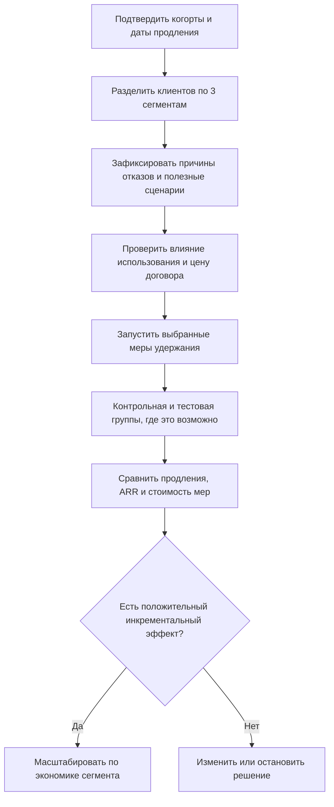

# ProjectPro — Retention и снижение оттока клиентов

**Кейс 2 · B2B SaaS · Годовой анализ клиентской базы**  
**Дата подготовки:** 23 октября 2026 г.  
**Формат:** аналитическое решение с расчётами, сегментной стратегией, метриками и проверкой научных источников.

---

## Краткое резюме и управленческий вывод

> **Главная проблема ProjectPro:** новые продажи почти полностью компенсируют потери клиентов по количеству, однако компания ежегодно теряет значительную часть существующей клиентской базы и потенциального повторяющегося дохода. **По числу уходящих клиентов приоритет диагностики — стартапы; по величине потерянного ARR — средний бизнес.** Корпоративные клиенты остаются стратегически значимыми из-за высокой стоимости каждого договора.

| Ключевой показатель | Результат |
|---|---:|
| Клиенты на начало года | 1 400 |
| Новые клиенты за год | 645 |
| Не продлили подписку | 625 |
| **Годовой Customer (Logo) Churn Rate** | **44,64%** |
| **Годовой Customer Retention Rate** | **55,36%** |
| **Потерянный годовой повторяющийся доход, churned ARR** | **$3 237 600** |
| Доля потерянного ARR от стартового ARR | 30,11% |
| Крупнейший источник потерь в деньгах | Средний бизнес — $1 286 400 (39,73% потерь) |
| Максимальный относительный отток клиентов | Стартапы — 55,06% |

**Рекомендация:** первым направлением инвестиций сделать удержание среднего бизнеса через внедрение работающих командных сценариев и сопровождение перед продлением; для стартапов — масштабируемое, простое и недорогое подключение к продукту; корпорациям — индивидуальную работу с результатами внедрения и ответственными за продление. Для всех сегментов сначала установить реальные причины ухода и проверить эффект мероприятий на сопоставимых группах.

### Что принимаем за основу расчётов

В условии не указано, какие именно клиенты могли не продлить подписку: только имевшиеся на начало года или также новые клиенты. **Для учебного расчёта принимаем, что 625 отказов относятся к 1 400 компаниям на начало года**, а новые клиенты исключены из знаменателя годового Retention. Это распространённое решение для анализа удержания *стартовой когорты*, но его необходимо подтвердить контрактными данными. Все финансовые оценки — по указанной **средней годовой цене подписки**, без учёта индивидуальных скидок, повышений и понижений тарифов.

---

## 1. Годовой Churn Rate: в целом и по сегментам

**Customer Churn Rate** — доля организаций из начальной клиентской базы, отказавшихся от продления за период.

$$
\text{Churn Rate} = \frac{\text{Число ушедших клиентов из стартовой базы}}{\text{Клиенты на начало года}}\times100\%.
$$

Пример для стартапов:

$$
\frac{468}{850}\times100\% = 55{,}06\%.
$$

| Сегмент | На начало года | Новые за год | Отказались от продления | **Годовой Churn** |
|---|---:|---:|---:|---:|
| Стартапы (≤20 сотрудников) | 850 | 425 | 468 | **55,06%** |
| Средний бизнес (21–100) | 420 | 168 | 134 | **31,90%** |
| Корпорации (101+) | 130 | 52 | 23 | **17,69%** |
| **Всего** | **1 400** | **645** | **625** | **44,64%** |

Общий расчёт:

$$
\text{Churn}_{total} = \frac{625}{1400}\times100\% = \boxed{44{,}64\%}.
$$

**Важно:** 44,64% — взвешенный по начальной численности клиентов показатель. Простое среднее трёх процентных значений (55,06%, 31,90%, 17,69%) использовать неправильно: сегменты отличаются по размеру.

### Наглядное сравнение

```text
Годовой отток организаций
Стартапы        55,06%  ████████████████████████████
Средний бизнес  31,90%  ████████████████
Корпорации      17,69%  █████████
```

У стартапов ежегодно уходит **больше половины стартовых клиентов**. Однако при оценке коммерческих потерь нужно учитывать стоимость контрактов, а не только число отказов.

---

## 2. Годовой Retention Rate по сегментам

**Customer Retention Rate** — доля компаний из начальной базы, сохранивших подписку к концу периода.

$$
\text{Retention Rate} = \frac{\text{Клиенты начала года} - \text{Ушедшие клиенты}}{\text{Клиенты начала года}}\times100\%.
$$

При одинаковых определениях и знаменателе: `Retention Rate = 100% − Churn Rate`.

| Сегмент | Клиентов на начало | Сохранили подписку из стартовой базы | **Годовой Retention** |
|---|---:|---:|---:|
| Стартапы | 850 | 382 | **44,94%** |
| Средний бизнес | 420 | 286 | **68,10%** |
| Корпорации | 130 | 107 | **82,31%** |
| **Всего** | **1 400** | **775** | **55,36%** |

Проверка сумм: `382 + 286 + 107 = 775`; `775 + 625 = 1 400`.

**Вывод:** корпоративный сегмент удерживается заметно лучше стартапов. Но даже высокий Retention не делает потерю крупного клиента финансово незначимой.

---

## 3. Финансовое влияние оттока

Для B2B SaaS корректнее говорить **churned ARR (Annual Recurring Revenue)** — годовой повторяющийся доход, соответствующий утраченным подпискам. Это **не фактически признанная выручка за прошедший год** и не автоматически равнозначно денежным убыткам.

$$
\text{Churned ARR}_{segment} = \text{Ушедшие клиенты}\times\text{Годовая стоимость подписки}.
$$

| Сегмент | Средняя подписка/год | Ушли | **Потерянный ARR** | Доля в общем потерянном ARR |
|---|---:|---:|---:|---:|
| Стартапы | $2 400 | 468 | **$1 123 200** | 34,69% |
| **Средний бизнес** | **$9 600** | **134** | **$1 286 400** | **39,73%** |
| Корпорации | $36 000 | 23 | **$828 000** | 25,57% |
| **Всего** | — | **625** | **$3 237 600** | **100%** |

Пример для среднего бизнеса: `134 × $9 600 = $1 286 400`.

### Сопоставление со стартовым ARR

| Сегмент | ARR на начало года | Потерянный ARR | Доля потерянного ARR внутри сегмента* |
|---|---:|---:|---:|
| Стартапы | $2 040 000 | $1 123 200 | 55,06% |
| Средний бизнес | $4 032 000 | $1 286 400 | 31,90% |
| Корпорации | $4 680 000 | $828 000 | 17,69% |
| **Всего** | **$10 752 000** | **$3 237 600** | **30,11%** |

\*При условии одинаковой средней цены у всех клиентов внутри соответствующего сегмента и отсутствии сокращения контрактов. Из-за одинаковых сегментных тарифов доля потерянного ARR внутри сегмента совпадает с логотипным Churn этого сегмента. В реальном SaaS эти показатели обычно различаются.

$$
\text{Потери стартового ARR} = \frac{3\,237\,600}{10\,752\,000}\times100\% = \boxed{30{,}11\%}.
$$

### Почему рост новых клиентов не решает проблему

Если также предположить, что новые 645 клиентов не ушли до конца года и цена подписки не менялась:

- Новых компаний: **645**; ушедших: **625**. Условный итог: `1 400 + 645 − 625 = 1 420`, прирост **всего 20 компаний** (+1,43% к стартовой базе).
- ARR новых подписок: `425 × $2 400 + 168 × $9 600 + 52 × $36 000 = $4 504 800`.
- Условный конечный ARR без изменений существующих тарифов: `$10 752 000 + $4 504 800 − $3 237 600 = $12 019 200`.
- Условный прирост ARR: **$1 267 200**, или около **11,79%** от начального ARR.

Это **сценарий на основе заданных усреднённых тарифов**, а не отчёт о признанной выручке: новые договоры могли быть заключены в разные месяцы, тарифы могли меняться, а также возможны дополнительные потери, расширения и скидки.

**Вывод:** компания может показывать рост общей стоимости подписок за счёт новых продаж и одновременно иметь серьёзную проблему удержания существующей клиентской базы.

---

## 4. Какой сегмент наиболее проблемный?

Нужно разделять два вопроса: **кто чаще уходит** и **где уход наносит наибольший финансовый ущерб**.

| Критерий | Наиболее проблемный сегмент | Обоснование |
|---|---|---|
| Частота ухода компаний | **Стартапы** | Churn 55,06%; 468 отказов |
| Абсолютные потери ARR | **Средний бизнес** | $1 286 400, максимальная сумма среди сегментов |
| Потеря одного клиента | **Корпорации** | $36 000 на один контракт, в 15 раз выше стартапа |
| Первый приоритет индивидуальной работы по экономике текущего кейса | **Средний бизнес** | Наибольший денежный разрыв при 134 ушедших клиентах |
| Первый приоритет массового продуктового улучшения | **Стартапы** | Наибольшая частота уходов; индивидуальное сопровождение каждого может быть слишком дорогим |

### Управленческий приоритет

1. **Средний бизнес — основное направление защиты ARR.** Уход сравнительно небольшого числа компаний даёт крупнейшие потери. Сегмент подходит для направленной работы с принятием продукта командами и решениями о продлении.
2. **Стартапы — основное направление улучшения самостоятельного использования продукта.** Отток наиболее высокий, но мероприятия должны масштабироваться без пропорционального роста стоимости Customer Success.
3. **Корпорации — защита крупных контрактов.** Отток относительно ниже, но ошибки при работе даже с одним клиентом дорого обходятся. Нужна персональная модель сопровождения, особенно перед сроком продления.

Этот порядок — **вывод из масштаба потерь и стоимости контрактов**, а не расчёт ожидаемой отдачи от инвестиций: стоимость обслуживания сегментов, маржинальность, текущая загрузка Customer Success и достижимый эффект мероприятий не даны.

---

## 5. Как интерпретировать данные об использовании функций

По условию среди **625 компаний, которые не продлили подписку**:

| Сценарий использования | Доля среди ушедших | Число компаний* |
|---|---:|---:|
| Использовали все ключевые функции | 40% | 250 |
| Использовали только базовые функции | 60% | 375 |
| **Итого** | **100%** | **625** |

\*Арифметика исходит из того, что 40% и 60% рассчитаны именно от компаний, а не от отдельных сотрудников.

**Критически важная методологическая оговорка:** из этих долей **нельзя доказать**, что ограниченное использование функций стало причиной оттока или что освоение всех функций обязательно повысит Retention.

Нам неизвестно:

- сколько клиентов **всего** использовали только базовые функции среди оставшихся и ушедших;
- чем отличаются сегменты по используемым функциям;
- почему компании выбирали базовый набор: возможно, он полностью закрывал их задачи;
- когда компания перестала использовать продукт и что происходило до отказа;
- были ли причины ухода связаны с ценой, потребностью, качеством, внутренним решением, конкурентом или бюджетом.

Чтобы проверить роль использования, нужна таблица **по всем клиентам**, а не только по ушедшим:

| Признак | Продлили | Не продлили | Риск отказа от продления |
|---|---:|---:|---:|
| Только базовые функции | `B_stay` | `B_churn` | `B_churn / (B_stay + B_churn)` |
| Все ключевые функции | `A_stay` | `A_churn` | `A_churn / (A_stay + A_churn)` |

Дополнительно нужно контролировать сегмент, длительность использования, фактические рабочие задачи и срок до продления. Даже обнаруженная зависимость будет **прогностической**, но не автоматически причинной.

**Практический вывод:** ProjectPro должен помогать клиентам достигать **нужного результата в управлении проектами**, а не заставлять их включать все доступные функции.

---

## 6. Научная база: какие решения действительно обоснованы

Ниже — **структурированный обзор релевантных первичных исследований**, а не исчерпывающий систематический обзор всей мировой литературы. Для исходных материалов использованы академические поисковые инструменты и страницы издателей. Где полный текст недоступен, вывод ограничен содержанием опубликованного аннотационного описания.

| Исследование | Дизайн / исходные данные | Проверенный результат | Что это означает для ProjectPro |
|---|---|---|---|
| **Sanchez Ramirez и др., 2024** [1] | Анализ реальных B2B данных; 3 959 подписок | Показатели использования продукта могут улучшать прогнозирование ухода; важны время и детализация использования | Измерять реальные рабочие действия команды **до** момента продления, а не только логины. **Прогноз ≠ причина.** |
| **Hochstein и др., 2023** [2] | Исследование практик Customer Success в B2B; развитие концептуальной модели | Customer Health включает качество отношений, использование и ценность, получаемую клиентом. Авторы признают, что не каждая реализация CS успешна | Не ограничивать «здоровье клиента» одним количеством активных пользователей; проверять достигнутый бизнес-результат |
| **Steinhoff и др., 2025** [3] | Многоэтапное исследование, включая данные B2B SaaS и опросы менеджеров | Избыточное пакетирование дополнительных сервисов на этапе подключения ассоциировано с худшим удержанием; вероятный механизм — сложность внедрения | Не стимулировать максимальное количество функций сразу. Сначала дать понятный рабочий сценарий и измеримый результат |
| **Guliyev и др., 2025** [4] | Бенчмаркинг моделей на 6 275 B2B-контрактах | Правила, указывающие на конкретные возможные действия, практичнее одного «churn score» | Выявлять не только риск, но и **какое действие** может помочь клиенту |
| **Ascarza, 2018** [5] | Два полевых эксперимента в других подписных отраслях | Клиенты с самым высоким риском ухода не всегда лучше всего отвечают на удерживающие меры | Выбирать аудиторию не только по вероятности ухода, но и по ожидаемой пользе вмешательства; проверять тестом |

### Что исследования **не** доказывают

- Не существует доказательства, что именно 60% пользователей базовых функций стали причиной потерь ProjectPro.
- Нет основания предсказывать точное увеличение Retention ProjectPro на определённое число процентных пунктов без собственного эксперимента.
- Эффекты из других компаний и отраслей нельзя механически перенести на стартапы, средний бизнес и корпорации ProjectPro.
- Увеличение числа внедрённых функций **не равно** улучшению ценности продукта: при сложном онбординге может наблюдаться обратный эффект [3].
- Сам по себе churn-скоринг не гарантирует эффективную кампанию по удержанию [5].

**Степень уверенности:** в арифметике кейса — высокая при явно указанных допущениях; в выборе экономического приоритета — высокая по абсолютному ARR, но без ROI; в причинах ухода — низкая из-за отсутствия данных о мотивах отказа и поведенческих контрфактах.

---

## 7. Сегментная стратегия: только три ключевых фокуса

### Фокус 1. Средний бизнес — удержать командную ценность и самый большой ARR

**Проблема:** $1,286 млн потерянного ARR — наибольший абсолютный ущерб из трёх сегментов. Неизвестно, получают ли команды клиента ожидаемую ценность от ProjectPro и закрепляется ли использование в рабочих процессах.

**Основное решение:** назначить ответственного за Customer Success для клиентов с существенным ARR и риском непродления; на первом этапе зафиксировать один-два критически важных командных сценария и довести их до использования. Например: проекты создаются, назначаются ответственные, задачи регулярно завершаются, статус виден руководителю. Затем проводить оценку достигнутой ценности до продления (например, за 90–120 дней).

**Проверяемая гипотеза:** сопровождение достижения конкретного результата повысит долю продлений среднего бизнеса по сравнению с сопоставимой группой без программы.

**Ключевой контроль:** годовой Retention и **сохранённый ARR**, а не число встреч с клиентом.

### Фокус 2. Стартапы — убрать сложность и быстрее показать пользу

**Проблема:** ежегодный Churn — 55,06%. Индивидуальное сопровождение сотен небольших компаний может быть экономически неэффективным.

**Основное решение:** самостоятельный сценарий «создать проект → пригласить команду → назначить и завершить задачи», шаблоны для типовых команд, контекстная помощь в интерфейсе. Не вынуждать пользователя осваивать дополнительные модули до появления потребности. Отдельно проверить, соответствует ли тариф возможностям небольших команд.

**Проверяемая гипотеза:** клиент, который быстро выполнил первый полезный командный сценарий, будет чаще продлевать подписку. Причинность проверять экспериментом, не только сравнением уже активных клиентов.

**Ключевой контроль:** Retention стартапов, достижение первого командного результата, время до него и стоимость сопровождения.

### Фокус 3. Корпорации — защитить крупные контракты

**Проблема:** всего 23 непродления, но $828 тыс. потерянного ARR. Каждый ушедший клиент условно стоит $36 тыс. годовой подписки.

**Основное решение:** персональный план удержания: закрепить владельца отношений и руководителя-спонсора на стороне клиента; регулярно обсуждать достигнутые результаты, препятствия внедрению и условия продления; задолго до окончания контракта согласовывать план решения проблем. Интеграции, права доступа и процессы согласования проверять там, где они действительно ограничивают использование.

**Проверяемая гипотеза:** раннее устранение конкретных препятствий и наличие согласованного бизнес-результата уменьшит вероятность непродления крупных контрактов.

**Ключевой контроль:** GRR/NRR по корпоративной стартовой базе, ARR продлений и доля крупных контрактов с подтверждённым планом продления.

### Сводная матрица стратегии

| Сегмент | Основной рычаг | Формат работы | Проверка результата |
|---|---|---|---|
| **Средний бизнес** | Доказать ценность командного использования | Customer Success + конкретные рабочие сценарии | Продление и сохранённый ARR |
| **Стартапы** | Упростить первые шаги | Самостоятельный онбординг и шаблоны | Активация + продление при контроле затрат |
| **Корпорации** | Устранять риски потери крупных контрактов | Персональная работа с заказчиком и спонсором | Контракты и ARR, продлённые в срок |

**Приоритет запуска:** сначала собрать фактические причины отказа и сравнить типы использования; затем внедрять программу для среднего бизнеса и облегчённый онбординг стартапов, сохраняя индивидуальное ведение крупных корпоративных продлений.

---

## 8. Метрики для отслеживания эффективности стратегии

### 8.1. Основные результативные метрики (lagging KPIs)

| Метрика | Как считать | Почему обязательна |
|---|---|---|
| **Annual Logo Churn Rate по сегментам** | Ушедшие компании из стартовой базы / компании стартовой базы | Показывает, снижается ли **сам факт** ухода клиентов; особенно важна стартапам |
| **Annual Logo Retention Rate по сегментам** | Продлившие компании из стартовой базы / компании стартовой базы | Главный ответ на задачу удержания; не размывается новыми клиентами |
| **Churned ARR по сегментам, $** | Сумма годовой стоимости утративших подписку контрактов | Обозначает реальную экономическую величину под риском; критичен для среднего бизнеса и корпораций |
| **Gross Revenue Retention (GRR)** | (ARR стартовых клиентов − ARR отмен − ARR сокращений) / ARR стартовых клиентов | Видно, сколько существующего ARR сохранено **без** маскировки допродажами |
| **Net Revenue Retention (NRR)** | (ARR стартовых клиентов − отмены − сокращения + расширения) / ARR стартовых клиентов | Показывает итоговую динамику ARR **той же начальной когорты**, включая расширение существующих договоров |

**Важно:** новые клиенты **не входят** в числитель GRR и NRR. Полноценные GRR и NRR **не вычислить** из условия задачи: неизвестны изменения цены и объёма уже существующих контрактов. Только при дополнительном допущении «нет никаких расширений/сокращений и цены постоянны» модельное GRR по кейсу равно **69,89%** (`1 − 3 237 600 / 10 752 000`). Нельзя выдавать эту величину за измеренный GRR.

### 8.2. Опережающие продуктовые и операционные метрики (leading KPIs)

| Метрика | Пример точного определения | Для какого решения нужна |
|---|---|---|
| **Time to First Team Value** | Медианное число дней от активации контракта до завершения первого командного проекта/этапа с участием ≥2 сотрудников | Показывает скорость достижения полезного результата, особенно у стартапов и среднего бизнеса |
| **Account-level Meaningful Adoption** | Доля организаций, в которых за последние 30 дней выполнен заранее определённый полезный сценарий (не просто вход в систему) | Помогает выявлять недостаточное внедрение без навязывания всех функций |
| **Team Coverage** | Доля приглашённых лицензированных пользователей, совершивших содержательное рабочее действие за последние 30 дней | Проверяет распространение продукта внутри организации; полезнее одного активного администратора |
| **Renewal Readiness** | Доля договоров с продлением в ближайшие 120 дней, для которых подтверждены ответственный, ценность, риски и следующий шаг | Дисциплина ранней работы со средним и крупным бизнесом |
| **Reason-coded Nonrenewal Rate** | Доля отказов по подтверждённым причинам с отдельной категорией «не установлено» | Проверяет, какую причину стоит реально устранять: ценность, цена, бюджет, сложность, конкурент и т. п. |
| **Cost per Saved ARR** | Дополнительные затраты на удержание / инкрементальный ARR, сохранённый за счёт вмешательства | Не позволяет тратить на спасение клиента больше экономической выгоды |

Первые четыре метрики **не должны подменять Retention**. Они позволяют раньше увидеть проблему и понять механизм улучшения, но успех оценивается по фактическим продлениям и деньгам.

### 8.3. Начальные значения и что нужно измерить

| KPI | Известный исходный уровень | Что отслеживать дальше |
|---|---:|---|
| Retention стартапов | **44,94%** | По сопоставимым годовым и renewal-когортам |
| Retention среднего бизнеса | **68,10%** | По renewal-когортам и размеру контракта |
| Retention корпораций | **82,31%** | Каждое крупное продление и ARR |
| Общий Logo Retention | **55,36%** | Без подмешивания новых клиентов |
| Churned ARR | **$3 237 600** | По сегментам, месяцам продления и причинам |
| GRR и NRR | **Неизвестны точно** | После подключения истории финансовых изменений |
| Достижение первого командного результата | **Неизвестно** | После настройки событий продукта |

---

## 9. Как проверить эффект: минимальный план измерения



**Как тестировать корректно:**

1. **Определить единицу рандомизации: клиентская компания**, не отдельный сотрудник. Иначе люди одного клиента будут обмениваться практиками и «загрязнять» эксперимент.
2. **Разделить клиентов на сравнимые группы внутри сегмента.** Учитывать даты ближайшего продления, размер ARR, стаж и исходную активность. У корпоративных клиентов тест может быть статистически ограничен из-за малого числа договоров; там применим аккуратный поэтапный запуск с историческим сравнением и разбором каждого кейса без чрезмерных причинных утверждений.
3. **Не выдавать раннюю активацию за удержание.** В течение 30–90 дней смотреть на рабочие сценарии и готовность к продлению; окончательное решение принимать после наступления контрактного события — продлил/не продлил.
4. **Проверять экономику:** `Инкрементально сохранённый ARR = (продления тестовой группы − ожидаемые продления при отсутствии меры) × соответствующий ARR`; сравнивать результат с расходами на Customer Success. Если контрактные суммы неоднородны, суммировать фактические значения, а не умножать на средний тариф.
5. **Контролировать отсев и смещение:** не исключать из анализа клиентов, которые не пришли на обучение; считать по первоначально назначенным группам (intention-to-treat), иначе программа может выглядеть эффективной только за счёт мотивированных участников.

### Иллюстративный экономический эффект (не прогноз)

Если гипотетически уменьшить количество отмен в **каждом сегменте на 10% относительно текущего числа отмен** при сохранении указанной цены, модельное снижение потерь ARR будет:

| Сегмент | Исходный churned ARR | Экономия 10% от churned ARR |
|---|---:|---:|
| Стартапы | $1 123 200 | $112 320 |
| Средний бизнес | $1 286 400 | $128 640 |
| Корпорации | $828 000 | $82 800 |
| **Всего** | **$3 237 600** | **$323 760** |

Это сценарий чувствительности, **не ожидаемый результат эксперимента**. В действительности нельзя сохранить долю клиента; для малых сегментов модельные ожидания нужно оценивать с учётом целочисленных контрактов, вероятности их продления и стоимости работ.

---

## 10. Независимая проверка выводов и ограничения

### Проверенные альтернативные объяснения

| Первоначальная гипотеза | Сильный контраргумент | Как проверить |
|---|---|---|
| «60% ушедших использовали только базовые функции — значит, надо внедрить все функции» | Нет базовых долей использования среди оставшихся; освоение лишних функций способно усложнить онбординг [3] | Сравнить всех клиентов, причины отказа и результаты селективных экспериментов |
| «Надо обзвонить всех клиентов с высоким churn score» | Высокий риск ухода не означает высокую чувствительность к удерживающей мере [5] | Оценить инкрементальный эффект удержания по группам, а не только точность предсказания |
| «Стартапы — всегда главный сегмент» | Наиболее частый уход не равен наибольшим денежным потерям | Рассчитать churned ARR, стоимость обслуживания и ожидаемую отдачу |
| «Количество клиентов растёт, значит всё хорошо» | Новые продажи могут скрыть высокий отток стартовой базы | Отдельно вести новые продажи, Logo Retention, GRR, NRR |
| «Корпорации удерживаются на 82%, ими можно не заниматься» | Потеря одного крупного контракта составляет до $36 000 в модели средних тарифов | Контролировать риск каждого крупного продления и фактический ARR |

### Что неизвестно и не должно додумываться

1. **Renewal-eligible denominator:** количество контрактов, действительно подлежавших продлению в течение года. Для строгого *renewal churn* знаменателем лучше брать все контракты, подошедшие к сроку продления, а не автоматически всех клиентов на 1 января.
2. Когорты ушедших: были ли среди них новые клиенты того же года; если да, расчёт стартовой когорты следует пересобрать по идентификаторам договоров.
3. Детальный тариф и структура договоров: изменение мест, тарифов, скидки, апсейл, даунсейл, мультиконтракты одной компании, частичные отмены.
4. Фактические причины отказов, частота использования конкретных сценариев у **всей** базы, удовлетворённость и качество сопровождения.
5. Себестоимость удержания, вклад в валовую прибыль, маржинальность и распределение нагрузки команды сопровождения. Поэтому нельзя обоснованно обещать конкретный ROI.

**Эффект независимой проверки:** сохранён вывод о приоритете среднего бизнеса по потерянному ARR, но отвергнута попытка объявить низкое использование функций доказанной причиной ухода. Уточнено, что прогнозирование риска и оптимальный выбор удерживающего действия — разные задачи [3], [5].

---

## 11. Финальный ответ на шесть вопросов кейса

1. **Годовой Churn Rate:** стартапы — **55,06%**, средний бизнес — **31,90%**, корпорации — **17,69%**, общая величина — **44,64%** при знаменателе 1 400 клиентов стартовой базы.
2. **Годовой Retention Rate:** стартапы — **44,94%**, средний бизнес — **68,10%**, корпорации — **82,31%**. Общий Retention — **55,36%**.
3. **Потерянный ARR:** стартапы — **$1 123 200**, средний бизнес — **$1 286 400**, корпорации — **$828 000**. Итого — **$3 237 600 годового повторяющегося дохода под риском**.
4. **Проблемный сегмент:** по доле ушедших компаний — **стартапы**, по абсолютной величине потерь — **средний бизнес**. Приоритет защиты выручки — средний бизнес; корпорации также требуют индивидуального контроля каждого договора.
5. **Стратегия:** для среднего бизнеса — подтверждённая ценность командных процессов и Customer Success перед продлением; для стартапов — короткий самостоятельный онбординг; для корпораций — персональный план ценности, рисков и продления.
6. **Метрики:** годовой Retention/Churn по сегментам и churned ARR оценивают итог; GRR/NRR — устойчивость повторяющегося дохода; скорость достижения первого командного результата, содержательная командная активность и готовность к продлению — ранние сигналы. Обязательно проверять **причинный эффект** мер, а не только корреляцию с использованием функций.

**Итоговая рекомендация:** не ограничиваться попыткой «обучить 60% клиентов всем функциям». Решение ProjectPro — **сегментная система достижения ценности и продления контрактов**, в которой приоритет определяется сочетанием размера утраченного ARR, вероятности сохранить клиента и стоимости вмешательства.

---

## Научные и методологические источники

**Дата проверки источников:** 23 октября 2026 года. Ссылки ведут на первичные публикации или страницы научных издателей.

1. **Sanchez Ramirez, J., Coussement, K., De Caigny, A., Benoit, D. F., Guliyev, E. (2024).** *Incorporating usage data for B2B churn prediction modeling.* Industrial Marketing Management, 120, 191–205. DOI: [10.1016/j.indmarman.2024.05.008](https://doi.org/10.1016/j.indmarman.2024.05.008). **Прочитано:** доступное авторское/издательское описание и аннотация; не все детали полной статьи открыты.
2. **Hochstein, B., Voorhees, C. M., Pratt, A. B., Rangarajan, D., Nagel, D. M., Mehrotra, V. (2023).** *Customer success management, customer health, and retention in B2B industries.* International Journal of Research in Marketing, 40(4), 912–932. DOI: [10.1016/j.ijresmar.2023.09.002](https://doi.org/10.1016/j.ijresmar.2023.09.002). **Прочитано:** издательская аннотация и доступный обзор; это преимущественно концептуальное/качественное исследование, не RCT об эффективности всех программ CS.
3. **Steinhoff, L., Kim, J. J., Kanuri, V. K., Palmatier, R. W. (2025).** *Unintended consequences of selling B2B digital subscription add-ons for customer onboarding.* Journal of the Academy of Marketing Science, 53, 1447–1481. DOI: [10.1007/s11747-025-01088-3](https://doi.org/10.1007/s11747-025-01088-3). **Прочитано:** открытая оригинальная статья с описанием методики, данных и выводов.
4. **Guliyev, E., Sanchez Ramirez, J., De Caigny, A., Coussement, K. (2025).** *Improving B2B customer churn through action rule mining.* Industrial Marketing Management, 125, 1–11. DOI: [10.1016/j.indmarman.2024.12.005](https://doi.org/10.1016/j.indmarman.2024.12.005). **Прочитано:** аннотация и открытое описание опубликованного исследования; практическая применимость алгоритма не означает доказанного causal uplift от каждого рекомендованного действия.
5. **Ascarza, E. (2018).** *Retention Futility: Targeting High-Risk Customers Might be Ineffective.* Journal of Marketing Research, 55(1). DOI: [10.1509/jmr.16.0163](https://doi.org/10.1509/jmr.16.0163); [копия авторской статьи](https://evaascarza.com/papers/ascarza_18.pdf). **Прочитано:** описание двух полевых экспериментов и материалы оригинального исследования. Результаты получены не на ProjectPro.
6. **Stripe (2026).** *Net revenue retention vs. gross revenue retention.* [Методологическая справка, обновлена 28 мая 2026 года](https://stripe.com/resources/more/net-revenue-retention-vs-gross-revenue-retention). Использована только для определения GRR и NRR, не как научное подтверждение эффективности действий.

### Метод расчёта и воспроизводимость

Все численные выводы в разделах 1–4 получены **не из научных публикаций, а из исходных данных кейса** и арифметических формул. Научные публикации используются исключительно для проверки интерпретации факторов оттока и обоснования выбора стратегии. Расчёты выполнены с неокруглёнными промежуточными значениями; проценты представлены с округлением до двух знаков.

**Проверка качества:** суммы клиентов, потерь и денежных величин сверены; граница между фактом, допущением, исследовательским результатом и управленческой гипотезой сохранена.
