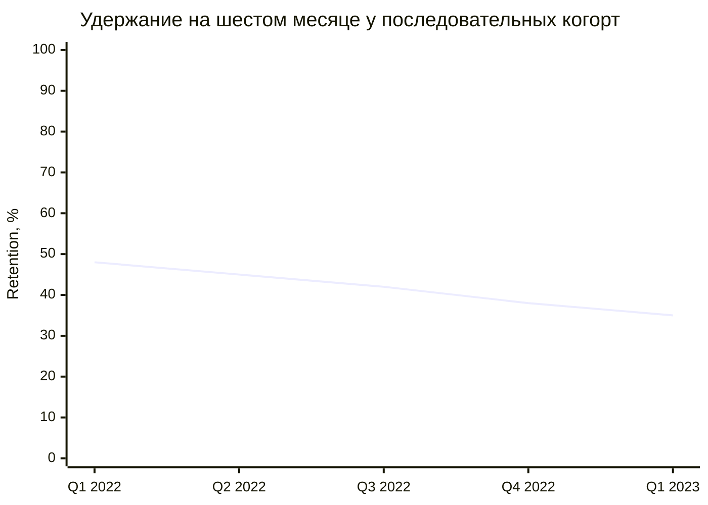
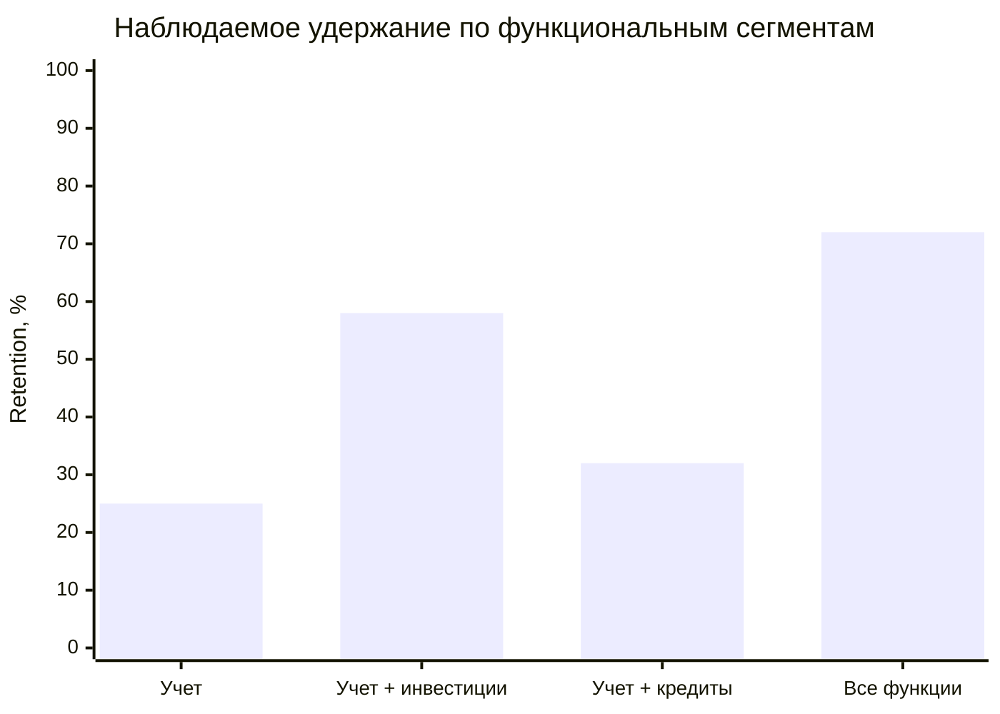
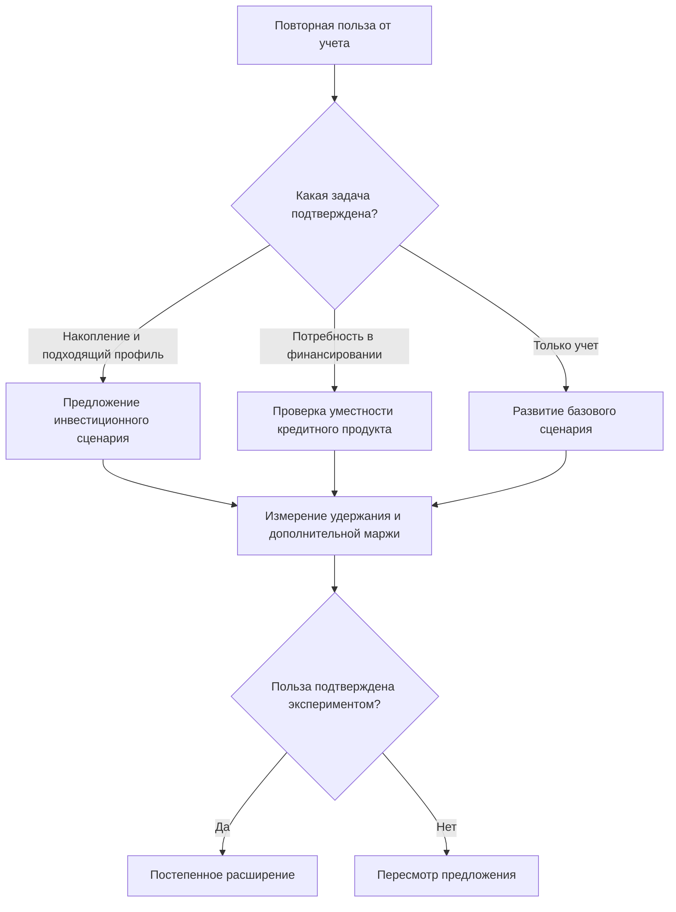

# FinanceApp: решение кейса по Retention и снижению оттока

**Кейс 3 · Курс по продукт-менеджменту · Подготовлено 6 ноября 2026 года**

## Короткий ответ

FinanceApp привлекает всё больше пользователей, но новые когорты удерживаются хуже: шестимесячный Retention Rate снизился с **48% до 35%**. Приоритет — улучшить повторную ценность учета финансов для самого большого сегмента и проверить адресный переход в инвестиционные сценарии. Массовый перевод всех пользователей в Ultra данными не обоснован.

| Вопрос задания | Результат | Что это означает для решения |
| :--- | :--- | :--- |
| Retention каждой когорты | **48%; 45%; 42%; 38%; 35%** | Качество удержания последовательно ухудшается |
| Средний шестимесячный Churn для формулы задания | **58,4%** | Это простое среднее пяти когорт, а не месячный отток |
| LTV по странам A / B / C / D / E | **$7,71 / $10,27 / $12,84 / $15,41 / $23,12** | Формальный ответ по заданной упрощенной формуле; период ARPU требует уточнения |
| Лучшие страны | **E — по LTV на пользователя; A — по LTV/CAC** | Высокий доход на клиента и эффективность привлечения дают разные рейтинги |
| Сильные функциональные сегменты | **Все функции — 72%; учет + инвестиции — 58%** | Это наблюдаемая связь с удержанием, причинный эффект подключения функций еще не установлен |
| Основные фокусы стратегии | **Ценность базового учета; уместные кросс-продажи; экономика по странам** | Изменения проверяются на удержании и дополнительной марже |

Все числовые результаты ниже получены из условия. Дополнительные сценарии, предположения и предложения помечены отдельно. Документ содержит решение, объяснение расчетов и инструкции для их воспроизведения; отдельные файлы для его понимания не нужны.

## 1. Исходные данные и границы анализа

### 1.1. Квартальные когорты

Когорта — группа пользователей, зарегистрировавшихся в одном квартале. Каждую группу сравниваем с ней самой через шесть месяцев после регистрации.

| Когорта регистрации | Новые пользователи, человек | Активные через 6 месяцев, человек |
| :--- | ---: | ---: |
| Q1 2022 | 180 000 | 86 400 |
| Q2 2022 | 210 000 | 94 500 |
| Q3 2022 | 240 000 | 100 800 |
| Q4 2022 | 270 000 | 102 600 |
| Q1 2023 | 300 000 | 105 000 |

### 1.2. Страны

| Страна | CAC, $ на привлеченного пользователя | ARPU, $ на пользователя за неуказанный период | Доля активной базы |
| :--- | ---: | ---: | ---: |
| A | 8 | 4,5 | 40% |
| B | 12 | 6,0 | 25% |
| C | 15 | 7,5 | 15% |
| D | 18 | 9,0 | 12% |
| E | 25 | 13,5 | 8% |

CAC — Customer Acquisition Cost, стоимость привлечения пользователя. ARPU — Average Revenue Per User, средняя выручка на пользователя за определенный период. В условии период ARPU не назван.

Страны обозначены буквами. Сведений об их языке, уровне доходов, законодательстве и развитости финансового рынка нет. Приписывать им характеристики реальных государств нельзя.

### 1.3. Использование функций и удержание

| Функциональный сегмент | Доля активных пользователей | Удержание через 6 месяцев |
| :--- | ---: | ---: |
| Только учет финансов | 60% | 25% |
| Учет + инвестиции | 15% | 58% |
| Учет + кредиты | 10% | 32% |
| Все три функции | 15% | 72% |

Все четыре группы взаимоисключающие по описанию. Их доли дают 100%. Групп «только инвестиции», «только кредиты» и «инвестиции + кредиты без учета» в условии нет.

### 1.4. Подписки

| Подписка | Цена из условия |
| :--- | ---: |
| Учет финансов | $1 500 |
| Инвестиции | $1 200 |
| Кредиты | $1 000 |
| Ultra, все три функции | $3 000 |

Цены сохранены буквально. Период оплаты, доля платящих пользователей и правила сложения подписок не указаны. Использование функции также не означает, что пользователь оплачивает соответствующую подписку.

### 1.5. Что принимается для решения, а что остается неизвестным

| Вопрос | Принятое правило | Последствие |
| :--- | :--- | :--- |
| Зрелость когорт | Все приведенные шестимесячные результаты считаются полностью наблюденными | Можно делить число активных на полный размер соответствующей когорты |
| Определение активности | Используем готовое число активных из условия | Нельзя задним числом заменить его на «оплатил подписку» или «открыл приложение» |
| Шестимесячный Churn | В учебном расчете равен `1 − R6` | Это доля неактивных в контрольном окне, а не доказательство окончательного ухода |
| Усреднение для LTV | Простое среднее Churn пяти когорт | Взвешенное среднее показываем отдельно как дополнительную проверку |
| Отток по странам | Один средний Churn для всех стран, как требует задание | Это расчетное допущение; равенство реального оттока стран не установлено |
| Период ARPU | Не придумываем отсутствующий период | Основной LTV остается формальным результатом задания; альтернативы разобраны отдельно |
| Состав функциональных групп | Доли относятся к активной базе; момент определения функционального сегмента неизвестен | Взвешивание этих долей на исторический Retention не дает автоматически Retention всех регистраций |
| База 1,2 млн | Это текущие активные пользователи в терминах условия | Не называем ее MAU, поскольку месяц измерения не указан |
| Экономика | Нет маржинальности, стоимости обслуживания, фондирования и кредитных потерь | Revenue LTV нельзя выдавать за прибыль |
| Страна × функции | Совместная таблица отсутствует | Точный рейтинг комбинаций вроде «E × Ultra» недоступен |

Число регистраций пяти когорт тоже равно 1,2 млн. Это арифметическое совпадение не доказывает, что эти регистрации и текущая активная база состоят из одних и тех же людей.

## 2. Задание 1. Шестимесячный Retention Rate

### 2.1. Формула и единицы

Retention Rate показывает, какая доля исходной когорты активна в заданный момент или интервал после регистрации.

$$
R_{6,i}=\frac{A_{6,i}}{N_i}\times100\%,
$$

где:

- $N_i$ — число регистраций в когорте $i$;
- $A_{6,i}$ — число пользователей этой же когорты, активных через шесть месяцев;
- $R_{6,i}$ — шестимесячное удержание в процентах.

Для Q1 2022:

$$
R_{6,Q1\,2022}=\frac{86\,400}{180\,000}\times100\%=48\%.
$$

То есть из каждых 100 зарегистрировавшихся пользователей 48 активны в шестимесячном контрольном окне, а 52 в нем неактивны.

### 2.2. Все расчеты

| Когорта | Расчет Retention | R6 | Churn = 1 − R6 | Неактивные в контрольном окне, человек |
| :--- | :--- | ---: | ---: | ---: |
| Q1 2022 | 86 400 / 180 000 | **48%** | 52% | 93 600 |
| Q2 2022 | 94 500 / 210 000 | **45%** | 55% | 115 500 |
| Q3 2022 | 100 800 / 240 000 | **42%** | 58% | 139 200 |
| Q4 2022 | 102 600 / 270 000 | **38%** | 62% | 167 400 |
| Q1 2023 | 105 000 / 300 000 | **35%** | 65% | 195 000 |
| Итого | 489 300 / 1 200 000 | **40,775% взвешенно** | **59,225% взвешенно** | **710 700** |

Контроль: `489 300 + 710 700 = 1 200 000`.

### 2.3. Как выглядит ухудшение



Горизонтальная ось показывает разные когорты регистрации. Это не помесячная кривая жизни одной когорты: данных для такой кривой в условии нет. Если просмотрщик не поддерживает Mermaid, все значения доступны в таблице выше.

Изменение между первой и последней когортой:

$$
35\%-48\%=-13\text{ процентных пунктов}.
$$

Относительное снижение:

$$
\frac{35\%-48\%}{48\%}\times100\%=-27{,}08\%.
$$

За тот же период размер новой квартальной когорты вырос на 66,67%: со 180 000 до 300 000. Число удержанных выросло только на 21,53%: с 86 400 до 105 000. Поэтому растущее абсолютное число активных само по себе не означает улучшения продукта.

### 2.4. Размер проблемы в понятных числах

Если бы последняя когорта удерживалась на уровне первой:

$$
300\,000\times48\%=144\,000.
$$

Фактическое значение — 105 000. Разница составляет:

$$
144\,000-105\,000=39\,000\text{ пользователей}.
$$

Это сценарная разница с историческим ориентиром. Она не доказывает, что конкретное улучшение вернет 39 000 человек: состав аудитории, страны и каналы привлечения могли измениться.

### 2.5. Простое и взвешенное среднее отвечают на разные вопросы

**Простое среднее** дает каждой квартальной когорте одинаковый вес:

$$
\overline R_6=\frac{48+45+42+38+35}{5}=41{,}6\%.
$$

$$
\overline C_6=\frac{52+55+58+62+65}{5}=58{,}4\%.
$$

**Взвешенное среднее** отвечает на вопрос о доле удержанных среди всех регистраций пяти когорт:

$$
R_{6,weighted}=\frac{489\,300}{1\,200\,000}=40{,}775\%.
$$

Разница объясняется тем, что поздние когорты крупнее и удерживаются хуже. В пункте 2 задания используем именно **58,4%**, поскольку требуется среднее значение Churn по когортам. Альтернативные 59,225% не подменяют основной ответ.

## 3. Задание 2. LTV по странам

### 3.1. Расчет строго по условию

LTV — Lifetime Value, ценность пользователя за время отношений с продуктом. В заданной формуле используется выручка, поэтому здесь рассчитывается **Revenue LTV**, без учета затрат.

$$
LTV_j=ARPU_j\times\frac{1}{\overline C_6}=\frac{ARPU_j}{0{,}584}.
$$

В знаменатель подставляем `0,584`, а не `58,4`. Промежуточный множитель:

$$
\frac{1}{0{,}584}=1{,}712328767.
$$

Для страны A:

$$
LTV_A=\frac{4{,}5}{0{,}584}=7{,}705479452\approx\$7{,}71.
$$

### 3.2. Итоговая таблица LTV и эффективности привлечения

| Страна | ARPU, $ | Расчет | LTV, $ | CAC, $ | LTV/CAC | LTV − CAC, $ |
| :--- | ---: | :--- | ---: | ---: | ---: | ---: |
| A | 4,5 | 4,5 / 0,584 | **7,71** | 8 | **0,963** | −0,29 |
| B | 6,0 | 6,0 / 0,584 | **10,27** | 12 | **0,856** | −1,73 |
| C | 7,5 | 7,5 / 0,584 | **12,84** | 15 | **0,856** | −2,16 |
| D | 9,0 | 9,0 / 0,584 | **15,41** | 18 | **0,856** | −2,59 |
| E | 13,5 | 13,5 / 0,584 | **23,12** | 25 | **0,925** | −1,88 |

Деньги округлены до двух знаков, отношения — до трех. Рейтинги и разницы рассчитаны из исходных, неокругленных значений.

В этой формальной модели все значения LTV/CAC меньше 1. **Если ARPU действительно относится к тому же шестимесячному периоду и выбранная модель применима**, ожидаемая выручка не покрывает даже CAC. Это условный вывод модели, а не установленная убыточность FinanceApp.

### 3.3. Почему период ARPU меняет экономический вывод

Формула `ARPU / Churn` требует одинакового периода двух величин. Из условия известен шестимесячный Churn; период ARPU неизвестен.

Множитель `1 / 0,584` при принятой модели выражен в шестимесячных периодах. Его нельзя назвать 1,71 месяца. Даже при согласованных периодах это приближение: предполагаются стабильные будущие доходы и отток, которых данные не подтверждают.

Если ARPU месячный, получить месячный Churn простым делением `58,4% / 6` нельзя. При дополнительном предположении постоянной месячной вероятности ухода и отсутствии реактиваций:

$$
(1-C_{month})^6=0{,}416,
$$

$$
C_{month}=1-0{,}416^{1/6}\approx13{,}5996\%.
$$

Тогда месячный вариант модели дал бы следующие значения:

| Страна | Основной формальный LTV из задания, $ | Сценарный LTV, если ARPU месячный и месячный Churn постоянен, $ |
| :--- | ---: | ---: |
| A | 7,71 | 33,09 |
| B | 10,27 | 44,12 |
| C | 12,84 | 55,15 |
| D | 15,41 | 66,18 |
| E | 23,12 | 99,27 |

Правый столбец — проверка чувствительности к допущениям. Это не исправленные фактические LTV и не замена ответу задания.

Можно построить и более грубую модель с `ARPU_6m = 6 × ARPU_month` и шестимесячным Churn. Для A она дала бы $46,23. Результат отличается от $33,09, потому что такое укрупнение иначе учитывает выручку пользователей, ушедших внутри полугодия. Без помесячных данных единственного «правильного пересчета» здесь нет.

**Практическое решение:** сдать формальные значения из пункта 3.2, сохранив оговорку о периоде ARPU. Перед реальным распределением бюджета согласовать период дохода, определение ухода и модель денежных потоков.

### 3.4. Насколько результат зависит от усреднения

Если вместо простого среднего использовать взвешенный Churn 59,225%, каждый LTV снизится примерно на 1,39%. Порядок стран при общем знаменателе не изменится.

Если использовать только последнюю когорту с Churn 65%, LTV снизится примерно на 10,15% относительно основной таблицы. Например, для E:

$$
\frac{13{,}5}{0{,}65}=\$20{,}77.
$$

Следовательно, среднее по старым и новым когортам может скрывать ухудшение экономики новых регистраций. Для операционных решений нужно смотреть свежие зрелые когорты отдельно.

## 4. Задание 3. Какие страны и функциональные сегменты наиболее выгодны

### 4.1. По странам нет одного победителя для всех задач

| Критерий | Результат | Обоснование |
| :--- | :--- | :--- |
| Выручка за жизнь одного пользователя по формуле | **E > D > C > B > A** | LTV пропорционален ARPU при одинаковом Churn |
| Выручка за жизнь на доллар привлечения | **A > E > B = C = D** | Нужно сравнивать LTV/CAC, а не только LTV |
| Масштаб текущей активной базы | **A > B > C > D > E** | Доли составляют 40%, 25%, 15%, 12%, 8% |
| Фактическая прибыльность | **Не определяется** | Нет расходов, потерь, странового удержания и согласованного периода ARPU |

Для B, C и D отношение `ARPU / CAC` одинаково и равно 0,5. Поэтому при общем Churn одинаков и LTV/CAC. Данные не дают основания ранжировать эти три страны по эффективности привлечения.

Число активных пользователей по странам можно оценить из текущей базы:

| Страна | Расчет | Активные пользователи, человек | Предварительная роль в стратегии |
| :--- | :--- | ---: | :--- |
| A | 1 200 000 × 40% | 480 000 | Основная площадка для улучшения массового базового сценария |
| B | 1 200 000 × 25% | 300 000 | Проверка странового удержания и каналов до изменения бюджета |
| C | 1 200 000 × 15% | 180 000 | Та же проверка; высокий ARPU сам по себе не улучшает LTV/CAC |
| D | 1 200 000 × 12% | 144 000 | Проверка стоимости обслуживания и дополнительной маржи |
| E | 1 200 000 × 8% | 96 000 | Адресные инвестиционные и пакетные предложения при подходящей потребности |
| Итого | 100% базы | **1 200 000** | Роли — предложение для проверки, не установленная характеристика рынков |

### 4.2. Почему даже небольшой разницы в удержании стран достаточно для смены рейтинга

Текущий рейтинг LTV/CAC получен с одинаковым Churn. Если удержание стран различается, порядок может измениться.

Например, оставим для A удержание 41,6%. Чтобы E обогнала A по LTV/CAC, должно выполняться:

$$
\frac{13{,}5}{25(1-R_E)}>\frac{4{,}5}{8\times0{,}584}.
$$

Отсюда:

$$
R_E>43{,}936\%.
$$

То есть достаточно, чтобы удержание E оказалось выше 43,94%, примерно на 2,34 процентного пункта выше принятого для A. Реального $R_E$ в условии нет. Этот пример показывает, почему по общей таблице нельзя окончательно перераспределять бюджет между странами.

### 4.3. По функциям можно ранжировать удержание, но не доказанную прибыль

| Место по удержанию | Сегмент | R6 | Churn | Разница с «только учет» | Отношение R6 к «только учет» |
| ---: | :--- | ---: | ---: | ---: | ---: |
| 1 | Все три функции | **72%** | 28% | +47 п.п. | 2,88 раза |
| 2 | Учет + инвестиции | **58%** | 42% | +33 п.п. | 2,32 раза |
| 3 | Учет + кредиты | **32%** | 68% | +7 п.п. | 1,28 раза |
| 4 | Только учет финансов | **25%** | 75% | База сравнения | 1,00 |

Если при одинаковых периодах и одинаковой выручке на пользователя механически применить `LTV = ARPU / Churn`, группа с Churn 28% даст LTV в `0,75 / 0,28 = 2,68` раза выше базовой. Для группы «учет + инвестиции» множитель равен `0,75 / 0,42 = 1,79`. Это условное сравнение: фактические ARPU и затраты сегментов неизвестны.

Наиболее перспективны для проверки монетизации пользователи с инвестиционным сценарием и пользователи всех функций. Самая крупная возможность улучшить удержание находится в базовом учете: его используют 60% активной базы, а наблюдаемое R6 составляет лишь 25%.

### 4.4. Что нельзя утверждать о комбинации «страна × функции»

Из отдельных таблиц нельзя установить, сколько в E пользователей Ultra, какой у них CAC, доход и удержание. Поэтому фраза «E × Ultra — самый прибыльный сегмент» не доказана.

Корректная гипотеза для проверки: **страна E интересна высоким ARPU, а использование всех функций связано с высоким удержанием; их сочетание стоит исследовать в совместном срезе**.

Для проверки нужна таблица с отдельной строкой на каждую комбинацию страны, когорты регистрации и функционального сегмента: численность на старте, активные на M6, выручка, переменные расходы, CAC и переходы между функциями. Общестрановой ARPU нельзя автоматически присвоить каждому функциональному сегменту страны.

## 5. Задание 4. Как несколько функций связаны с удержанием

### 5.1. Важен состав функций



Две группы используют по две функции, но их удержание различается на **26 п.п.**: 58% у учета с инвестициями против 32% у учета с кредитами. Следовательно, одной метрики «количество подключенных функций» недостаточно.

| Сравнение наблюдаемых групп | Разница R6 | Что можно заключить |
| :--- | ---: | :--- |
| Учет + инвестиции против только учета | +33 п.п. | Инвестиционный сценарий связан с существенно более высоким удержанием |
| Учет + кредиты против только учета | +7 п.п. | Связь слабее, чем у инвестиционного сценария |
| Все функции против учета + инвестиции | +14 п.п. | У группы с тремя функциями удержание выше и в этом сравнении |
| Все функции против учета + кредиты | +40 п.п. | Наличие инвестиционного сценария снова отделяет более удерживаемую группу |

Это описательные сравнения разных пользователей. Они не измеряют эффект подключения функции одному и тому же человеку.

### 5.2. Как посчитать среднее удержание пользователей нескольких функций

В долях текущей активной базы несколько функций используют:

$$
15\%+10\%+15\%=40\%.
$$

Если условно использовать эти доли как веса, получится:

$$
R_{multi,proxy}=\frac{0{,}15\times0{,}58+0{,}10\times0{,}32+0{,}15\times0{,}72}{0{,}40}
=56{,}75\%.
$$

По сравнению с 25% у базового учета разница равна 31,75 п.п.; отношение — 2,27 раза.

**Ограничение:** 56,75% — условное среднее с весами активной базы. Для корректного когортного удержания нужны доли этих групп в исходной когорте до измерения результата. Их нет в условии.

### 5.3. Почему 37,7% нельзя выдать за общий Retention FinanceApp

Механическое взвешивание всех четырех групп дает:

$$
R_{mix,proxy}=0{,}60\times0{,}25+0{,}15\times0{,}58+0{,}10\times0{,}32+0{,}15\times0{,}72
=37{,}7\%.
$$

Но это не совпадает ни с простым средним когорт 41,6%, ни с фактическим объединенным результатом когорт 40,775%.

Само различие не доказывает ошибку условия. В таблицах могут быть разные периоды, исходные аудитории и правила определения групп. Проблема в том, что веса известны для активных пользователей, а для агрегации удержания нужны веса на старте наблюдения.

Поэтому далее 37,7% используется только как **база условной модели функционального состава**. Ее нельзя смешивать с когортными 41,6% или 35%.

### 5.4. Какие альтернативные объяснения надо проверить

| Возможное объяснение связи | Почему оно меняет вывод | Проверка |
| :--- | :--- | :--- |
| Более мотивированные пользователи сами выбирают больше функций | Высокий Retention может предшествовать кросс-продаже | Рандомизированное предложение второй функции |
| Долго живущие пользователи успевают подключить дополнительные функции | Классификация по будущему поведению создает временное смещение | Фиксировать сегмент до начала отсчета результата; учитывать дату подключения |
| Группы различаются страной, доходом или каналом привлечения | Разница может объясняться составом аудитории | Сравнение внутри одинаковых стран, когорт, каналов и стажа |
| Активный кредит требует обслуживания | Платежи могут отражать обязательство, а не желание пользоваться продуктом | Раздельные метрики обязательных платежей и добровольной активности |

На агрегатах кейса причинное объяснение выбрать нельзя. Рабочая гипотеза — полезный инвестиционный сценарий способен улучшить удержание части аудитории. Проверять нужно результат предложения, а не заранее обещать рост на 33 п.п.

## 6. Как использовать данные о цене подписок

Цены не входят в формулу LTV из задания: она уже использует ARPU. Подстановка стоимости подписки вместо ARPU дала бы новую модель с неизвестной долей платящих пользователей.

При дополнительном предположении, что цены относятся к одному периоду и отдельные подписки складываются, можно сравнить упаковку:

| Набор подписок | Условная сумма отдельных цен | Ultra | Разница |
| :--- | ---: | ---: | :--- |
| Учет + инвестиции + кредиты | $3 700 | $3 000 | Ultra дешевле на $700, или 18,92% |
| Учет + инвестиции | $2 700 | $3 000 | Доплата за Ultra — $300, или 11,11% |
| Учет + кредиты | $2 500 | $3 000 | Доплата за Ultra — $500, или 20% |
| Только учет | $1 500 | $3 000 | Доплата за Ultra — $1 500, или 100% |

Практический вывод: при подтверждении этих правил пакет может быть уместнее для людей, которым уже нужны несколько направлений. Пользователю только учета предлагается удвоение расходов, и наблюдаемое удержание другой группы не доказывает, что он согласится на такое предложение.

Цены в тысячах долларов сильно отличаются по масштабу от ARPU в единицах долларов. Это повод проверить период оплаты, валюту, долю платящих и наличие бесплатного тарифа. Это не основание самостоятельно заменить $1 500 на $15 или считать опечатку доказанной.

До уточнения этих параметров можно тестировать интерес к пакетному предложению, но нельзя надежно прогнозировать подписочную выручку по ценам кейса.

## 7. Задание 5. Стратегия: три основных фокуса

Цель — увеличить число пользователей, получающих повторную пользу от FinanceApp, и дополнительную маржу от этих отношений. Количество открытых экранов, выданных кредитов или подключенных функций само по себе не является целью удержания.

### Фокус 1. Улучшить повторную ценность учета финансов

**Основание:** 60% активной базы используют только учет; их R6 — 25%. Улучшение этого сценария затрагивает самый большой сегмент и не требует, чтобы каждый пользователь начал инвестировать или брать кредит.

**Предлагаемое изменение:** строить активацию вокруг одной выбранной финансовой задачи. Например, пользователь задает бюджет, видит собственные расходы и в следующий расчетный период получает сравнение с планом. Повторный визит нужен для решения задачи, поэтому частота подсказок связана с финансовым циклом и согласием пользователя.

**Первый эксперимент:** сравнить действующий сценарий учета с таким циклом «план → фактические расходы → полезный итог → корректировка». Измерять повторное полезное действие на M1 и M3, а окончательный эффект — на M6. Рост ранней активности не заменяет шестимесячного результата.

**География:** начать проверку в A из-за масштаба 480 000 активных пользователей и лучшего формального LTV/CAC. Внутри страны сохранить разбиение по каналам и когортам; затем проверить переносимость эффекта на остальные страны.

**Экономическая проверка:** дополнительная маржа должна покрывать стоимость изменения и коммуникаций. Отдельно контролировать жалобы, отключение сообщений и ухудшение завершения базовой задачи.

### Фокус 2. Предлагать следующую функцию по финансовой потребности

**Основание:** у сегмента «учет + инвестиции» R6 составляет 58%, у «учет + кредиты» — 32%. Разница оправдывает приоритет проверки инвестиционного перехода, но не позволяет применять его ко всем пользователям.

**Предлагаемое изменение:** после подтвержденной потребности предложить один следующий сценарий. Пользователю с целью накопления и подходящим финансовым профилем — инвестиционный сценарий; пользователю с запросом на финансирование — кредитный, после необходимых проверок продукта. Если второй сценарий не нужен, развивать учет.



**Ultra:** предлагать после подтверждения потребности в нескольких направлениях и проверки тарификации. Не использовать заем или рост частоты сделок как искусственный способ удержать пользователя.

**Первый эксперимент:** случайно разделить подходящих пользователей базового учета на контроль и группу с адресным предложением инвестиционного сценария. Оценивать всех назначенных пользователей, включая тех, кто отказался от предложения.

**Показатели:** шестимесячное удержание, дополнительная маржа на назначенного пользователя, повторное полезное использование второй функции. Для кредитных сценариев дополнительно учитывать ожидаемые потери и качество обслуживания долга. Для инвестиционных — обращения и жалобы, а не только объем операций.

### Фокус 3. Распределять усилия по страновой экономике

**Основание:** E лидирует по LTV, A — по LTV/CAC; B, C и D равны по формальной эффективности привлечения. Отсутствует удержание по странам, поэтому полный перенос бюджета в E преждевременен.

**Предлагаемое решение:** разделить улучшение существующей базы и закупку новых пользователей. У существующего пользователя CAC уже понесен; решение об адресном предложении зависит от дополнительных доходов, затрат и риска. Для нового пользователя нужно отдельно покрыть CAC.

| Страны | Основной акцент | Что необходимо подтвердить перед расширением |
| :--- | :--- | :--- |
| A | Базовое удержание на большой аудитории; доступный следующий полезный сценарий | Дополнительная маржа и отсутствие ухудшения базовой активации |
| B / C / D | Когорты и экономика по каналам внутри каждой страны | Отличия в удержании, расходах и эффективности, скрытые общими средними |
| E | Проверка инвестиционных и пакетных предложений для подходящих пользователей | Страновой Churn, готовность платить и стоимость обслуживания при высоком CAC |

Локализация проверяется по конкретным барьерам: язык, подключение финансовых счетов, доступные способы оплаты и прохождение необходимых процедур. В кейсе нет данных, какой из этих барьеров существует в конкретной стране; это направления диагностики, а не установленная причина оттока.

Решение о расширении принимается по **инкрементальной марже на пользователя и на единицу бюджета**, при сопоставимых периодах и достаточной зрелости когорт. Страновые эффекты сначала рассматриваются отдельно: общий положительный результат может скрыть ухудшение одного рынка.

## 8. Размер возможностей: сценарии, а не обещание эффекта

Чтобы сравнить направления без подмены реальных когорт текущей активной базой, используем **условные 100 000 пользователей на старте наблюдения**. Предполагаем, что их начальные доли функций равны долям из условия и что сегментные R6 применимы к этой аудитории. Это дополнительные предположения.

При них базовый результат функциональной модели:

$$
100\,000\times37{,}7\%=37\,700\text{ удержанных}.
$$

### 8.1. Сравнение двух направлений

| Сценарий | Расчет дополнительного удержания | Изменение общего R6 модели | Дополнительные удержанные на 100 000 |
| :--- | :--- | ---: | ---: |
| Повысить R6 базового учета с 25% до 30% | 60% × (30% − 25%) | **+3,00 п.п.** | **3 000** |
| Перевести 10 п.п. всей базы из учета в учет + инвестиции | 10% × (58% − 25%) | **+3,30 п.п.** | **3 300** |
| Перевести 10% пользователей базового учета в учет + инвестиции | 60% × 10% × (58% − 25%) | **+1,98 п.п.** | **1 980** |

Второй сценарий означает переход 10 000 человек, то есть 16,67% исходного базового сегмента. Третий — переход 6 000 человек. «10 п.п. всей базы» и «10% базового сегмента» дают разные результаты.

В сценарии перевода 10 п.п. условный функциональный состав меняется с `60 / 15 / 10 / 15` на `50 / 25 / 10 / 15`, а показатель модели — с 37,7% до 41,0%.

Эти расчеты показывают масштаб возможного результата при заданных предпосылках. Они не доказывают, что переведенные пользователи получат удержание существующих инвестиционных пользователей. Для планирования инвестиционного перехода нужна оценка причинного эффекта эксперимента.

Практический выбор между улучшением учета и кросс-продажей зависит от полученного эффекта, стоимости внедрения и маржи. Сравнивать только разрыв 58% против 25% недостаточно.

### 8.2. Как считать экономический эффект без выдуманного ARPU сегментов

Для сравнения эксперимента с контролем:

$$
\Delta CM_{6,user}=\overline{CM}_{6,treatment}-\overline{CM}_{6,control},
$$

где $CM$ — накопленная маржа за одинаковые шесть месяцев: выручка за вычетом относимых переменных затрат и ожидаемых кредитных потерь. Доходы и расходы учитываются по одной согласованной методике.

Тогда оценка результата расширения:

$$
\Delta\Pi_6=N_{eligible}\times\Delta CM_{6,user}-Cost_{rollout}.
$$

Расходы, уже включенные в пользовательский $CM$, повторно в $Cost_{rollout}$ не вычитаются. Для новой аудитории отдельно учитывается инкрементальный CAC. Выдача основной суммы кредита и клиентские инвестиционные активы не считаются выручкой приложения.

В условии нет значений для этих переменных. Поэтому денежный эффект стратегии не подставляется произвольными числами.

## 9. Как доказать, что стратегия работает

### 9.1. Определение полезного удержания для будущих измерений

Для пересчета данных кейса используется исходное определение активности. Для новых экспериментов предлагается заранее зафиксировать более содержательные события:

| Направление | Пример полезного события | Что не подходит как единственное подтверждение |
| :--- | :--- | :--- |
| Учет | Пользователь просмотрел собственный итог расходов и проверил или скорректировал бюджет | Фоновое открытие приложения или доставка push |
| Инвестиции | Осознанно проверил портфель относительно цели или выполнил запланированное действие | Автоматическое обновление котировок; требование обязательно торговать |
| Кредиты | Решил задачу управления графиком или платежом | Только наличие непогашенного долга как признак лояльности |

Для кредитов отдельно показываются обязательная сервисная активность и добровольное использование остальных возможностей. Иначе показатель может поощрять удержание через обязательство.

Предлагаемое определение M6 для регистрации: хотя бы одно согласованное полезное событие в интервале от шестимесячной до семимесячной годовщины регистрации. Каждый пользователь считается один раз; знаменатель — исходная подходящая когорта. Используются календарные месяцы и согласованный часовой пояс. Это предложенный контракт новой метрики, а не реконструкция неизвестного окна исходного кейса.

### 9.2. Карточка первого эксперимента

| Поле | Конкретное решение |
| :--- | :--- |
| Гипотеза | Адресное предложение инвестиционного сценария улучшит удержание подходящих пользователей учета и даст положительную дополнительную маржу |
| Аудитория | Пользователи только учета, определенные до начала теста; предложение соответствует потребности и требованиям инвестиционного продукта |
| Момент старта | Общий момент включения в эксперимент $t_0$; все признаки отбора фиксируются до назначения группы |
| Контроль | Действующий опыт |
| Тест | Одно адресное предложение, связанное с финансовой задачей пользователя |
| Единица рандомизации | Пользователь с постоянным идентификатором; распределение 50/50 внутри страны и сопоставимого стажа |
| Основная метрика | $R_{6,exp}$: доля назначенных пользователей с полезной активностью в шестом месяце после $t_0$ |
| Ранние сигналы | Первая полезная активация второй функции; R1 и R3; они не заменяют основную метрику |
| Экономическое условие | Положительная дополнительная маржа после учета затрат на предложение и обслуживание |
| Ограничители | Жалобы, отказ от сообщений, ухудшение базового сценария; применимые продуктовые и риск-показатели |
| Способ анализа | Intention-to-treat: сравнение всех назначенных в тест и контроль, независимо от принятия предложения |
| Решение | Расширять только при достаточном эффекте, приемлемых ограничителях и подтвержденной экономике; неопределенный результат не считать победой |

Здесь $R_{6,exp}$ отсчитывается от начала эксперимента. Он не тождественен исходному R6 после регистрации, если $t_0$ наступает позже. Оба показателя нужно подписывать и хранить раздельно.

Сравнение только тех, кто подключил инвестиции, с теми, кто не подключил, нарушит рандомизацию. Оно снова смешает эффект предложения с исходной мотивацией пользователей.

### 9.3. Пример расчета необходимого размера теста

**Предположения для планирования:** контрольное удержание — 25%, минимальный интересующий результат — 30%, двусторонний уровень значимости — 5%, мощность — 80%, равные независимые группы. Это один основной тест; поправки на несколько одновременно проверяемых гипотез сюда не включены.

Исторические 25% взяты как ориентир из кейса. У аудитории эксперимента и другого момента старта показатель может отличаться, поэтому перед запуском ориентир надо пересчитать на сопоставимой выборке.

При $p_0=0{,}25$, $p_1=0{,}30$, $\overline p=0{,}275$ нормальная аппроксимация для числа участников в одной группе:

$$
n\approx\frac{\left[1{,}96\sqrt{2\overline p(1-\overline p)}+0{,}8416\sqrt{p_0(1-p_0)+p_1(1-p_1)}\right]^2}{(p_1-p_0)^2}
\approx1\,251.
$$

Для планирования удобно округлить до **1 300 пользователей на группу**, всего 2 600. Если заранее обосновано, что около 10% записей не смогут дать технически надежное измерение, плановый набор составит примерно `1 251 / 0,9`, то есть 1 390 человек на группу; можно округлить до 1 400.

Уход пользователя из приложения — измеряемый исход, а не причина исключать его из теста. Технически отсутствующие данные также нельзя автоматически отбрасывать, если пропуски зависят от группы. Резерв набора не исправляет смещение измерения.

Расчет относится к общему двухгрупповому сравнению. Он не обеспечивает такую же мощность отдельно в каждой из пяти стран. Страновые выводы потребуют собственного расчета или более длительного набора.

### 9.4. Проверки перед интерпретацией результата

- Пользователь сохраняет одну группу; назначения и события не задваиваются.
- Состав теста и контроля соответствует запланированному распределению; причины отклонений выяснены.
- Одинаковые определения полезной активности, доходов и затрат действуют в обеих группах.
- Все включенные в основной итог пользователи получили полное окно наблюдения; свежие записи не записываются в ушедшие.
- Основная метрика и момент завершения анализа определены заранее; случайное раннее улучшение не используется для досрочного объявления победы.
- Эффект показан с доверительным интервалом, абсолютной разницей в п.п. и экономическим результатом.

Для оценки долгосрочного эффекта нужен M12 и наблюдение за поздним оттоком. Показатели на M1 и M3 полезны для диагностики, но по ним нельзя обещать подтвержденный M6 или M12.

### 9.5. Предлагаемая последовательность работ

| Этап | Что сделать | Условие перехода |
| :--- | :--- | :--- |
| Подготовка измерения | Согласовать ARPU, окно активности, тарификацию и страновые срезы; проверить события | Метрики воспроизводятся, существенные расхождения объяснены |
| Два ограниченных теста | Проверить повторную ценность учета и адресное инвестиционное предложение на разделенных аудиториях | Назначения и сбор данных работают корректно |
| Ранние чтения M1 / M3 | Проверить достижение пользы и ограничители | Нет оснований остановить тест из-за вреда или дефекта измерения |
| Основной итог M6 | Дождаться полного окна и оценить удержание с дополнительной маржой | Решение опирается на заранее выбранные критерии |
| Долгий горизонт M12 | Проверить устойчивость эффекта и отложенные потери | Расширение сохраняет экономический смысл |

Это последовательность оценки, а не обещание завершить шестимесячный тест за несколько недель.

## 10. Как воспроизвести расчеты в Excel или Google Sheets

Для пяти когорт достаточно прозрачной таблицы. Отдельная BI-система для решения учебного задания не требуется. Ниже — точная структура, которую можно перенести в Excel или Google Sheets. Сама книга не является дополнительным приложением к этому MD-документу.

Формулы записаны с английскими именами функций и запятыми между аргументами. Конкретная локаль может требовать переведенных имен и разделителя `;`. Все проценты хранятся как доли: `48% = 0,48`.

### 10.1. Лист `Cohorts`

| Столбец | Содержимое | Формула для строки 2 |
| :--- | :--- | :--- |
| A | Когорта | `Q1 2022` |
| B | Новые пользователи | `180000` |
| C | Активные на M6 | `86400` |
| D | Retention | `=C2/B2` |
| E | Churn | `=1-D2` |
| F | Неактивные | `=B2-C2` |

Данные остальных когорт находятся в строках 3–6. Формулы D2:F2 копируются вниз до строки 6. Для D и E устанавливается процентный формат.

Строка 7 содержит итоги:

- B7: `=SUM(B2:B6)` → 1 200 000;
- C7: `=SUM(C2:C6)` → 489 300;
- D7: `=C7/B7` → 40,775%, взвешенный Retention;
- E7: `=1-D7` → 59,225%, взвешенный Churn;
- F7: `=SUM(F2:F6)` → 710 700.

В отдельной строке 9:

- D9: `=AVERAGE(D2:D6)` → 41,6%;
- E9: `=AVERAGE(E2:E6)` → **58,4%, значение для задания 2**.

Среднее не должно включать строку 7 с уже рассчитанным итогом.

### 10.2. Лист `Countries`

В строках 2–6 расположены страны A–E.

| Столбец | Содержимое | Формула для строки 2 |
| :--- | :--- | :--- |
| A | Страна | `A` |
| B | CAC | `8` |
| C | ARPU | `4.5` |
| D | Доля активной базы | `40%` |
| E | Формальный LTV | `=C2/Cohorts!$E$9` |
| F | LTV/CAC | `=E2/B2` |
| G | LTV − CAC | `=E2-B2` |
| H | Активные пользователи | `=1200000*D2` |

Ссылка `$E$9` фиксируется, чтобы при копировании формулы не поменялся знаменатель. Округление используется в формате отображения ячейки, а не внутри последующих вычислений.

Проверки: `=SUM(D2:D6)` должно дать 100%, `=SUM(H2:H6)` — 1 200 000. При одинаковом Churn отношения в строках B, C и D должны совпасть до погрешности вычислений.

### 10.3. Лист `Functions`

В строках 2–5 расположены четыре функциональные группы в исходном порядке.

| Столбец | Содержимое | Формула для строки 2 |
| :--- | :--- | :--- |
| A | Функциональная группа | `Только учет` |
| B | Доля активной базы | `60%` |
| C | R6 группы | `25%` |
| D | Churn группы | `=1-C2` |
| E | Активные пользователи группы | `=1200000*B2` |
| F | Вклад в условный показатель состава | `=B2*C2` |

Результаты:

- `=SUM(B2:B5)` → 100%;
- `=SUM(E2:E5)` → 1 200 000;
- `=SUMPRODUCT(B2:B5,C2:C5)` → **37,7%, условный показатель**, не общий Retention регистраций;
- `=SUMPRODUCT(B3:B5,C3:C5)/SUM(B3:B5)` → **56,75%, условное среднее нескольких функций**.

Численность текущих активных групп: 720 000; 180 000; 120 000; 180 000. Их нельзя умножить на исторические Retention и назвать полученное число фактическим количеством оставшихся через следующие полгода.

### 10.4. Какие визуализации полезны

| Визуализация | Данные | Настройка и смысл |
| :--- | :--- | :--- |
| Линия R6 последовательных когорт | `Cohorts!A2:A6` и `D2:D6` | Ось Y 0–100%; подпись «R6 каждой когорты» |
| Столбцы R6 функций | `Functions!A2:A5` и `C2:C5` | Нулевая база; точные значения 25 / 58 / 32 / 72 |
| Таблица LTV и LTV/CAC | `Countries!A2:G6` | Два отдельных рейтинга; примечание о периоде ARPU |

На одном графике нельзя соединять эти пять когорт как месяцы жизни одного пользователя. Нельзя также достраивать M1–M5 или M12 из единственной точки M6.

## 11. Независимая арифметическая проверка на Python

Код использует стандартную библиотеку Python и точные десятичные расчеты. Его можно целиком скопировать и выполнить. Он воспроизводит основной ответ, дополнительные сценарии и контрольные равенства; внешние файлы и сетевой доступ не нужны.

```python
from decimal import Decimal, getcontext
from math import ceil, sqrt

getcontext().prec = 40
D = Decimal

cohorts = [
    ("Q1 2022", D("180000"), D("86400")),
    ("Q2 2022", D("210000"), D("94500")),
    ("Q3 2022", D("240000"), D("100800")),
    ("Q4 2022", D("270000"), D("102600")),
    ("Q1 2023", D("300000"), D("105000")),
]

countries = [
    ("A", D("8"), D("4.5"), D("0.40")),
    ("B", D("12"), D("6.0"), D("0.25")),
    ("C", D("15"), D("7.5"), D("0.15")),
    ("D", D("18"), D("9.0"), D("0.12")),
    ("E", D("25"), D("13.5"), D("0.08")),
]

features = [
    ("Только учет", D("0.60"), D("0.25")),
    ("Учет + инвестиции", D("0.15"), D("0.58")),
    ("Учет + кредиты", D("0.10"), D("0.32")),
    ("Все функции", D("0.15"), D("0.72")),
]

retention = [active / new for _, new, active in cohorts]
churn = [D(1) - r for r in retention]
mean_retention = sum(retention) / D(len(retention))
mean_churn = sum(churn) / D(len(churn))
total_new = sum(new for _, new, _ in cohorts)
total_active = sum(active for _, _, active in cohorts)
weighted_retention = total_active / total_new

assert retention == [D(".48"), D(".45"), D(".42"), D(".38"), D(".35")]
assert mean_churn == D(".584")
assert mean_retention + mean_churn == 1
assert total_new == D("1200000")
assert total_active == D("489300")
assert total_new - total_active == D("710700")
assert weighted_retention == D(".40775")
assert sum(share for _, _, _, share in countries) == 1
assert sum(share for _, share, _ in features) == 1

print("Когорты, R6 и Churn:")
for (label, _, _), r, c in zip(cohorts, retention, churn):
    print(label, f"R6={r:.2%}", f"Churn={c:.2%}")
print("Средний Churn:", f"{mean_churn:.2%}")
print("Взвешенный Retention:", f"{weighted_retention:.3%}")

print("Страна, LTV, LTV/CAC, LTV-CAC:")
ratios = {}
for label, cac, arpu, share in countries:
    ltv = arpu / mean_churn
    ratios[label] = ltv / cac
    print(label, f"${ltv:.2f}", f"{ltv / cac:.3f}", f"${ltv-cac:.2f}")

# Деление Decimal может различаться в самом последнем разряде.
assert abs(ratios["B"] - ratios["C"]) < D("1e-35")
assert abs(ratios["C"] - ratios["D"]) < D("1e-35")
assert ratios["A"] > ratios["E"] > ratios["B"]

mix_proxy = sum(share * r for _, share, r in features)
multi_proxy = (
    sum(share * r for _, share, r in features[1:])
    / sum(share for _, share, _ in features[1:])
)
assert mix_proxy == D(".377")
assert multi_proxy == D(".5675")

shift_all = D(".10") * (D(".58") - D(".25"))
shift_basic = D(".60") * D(".10") * (D(".58") - D(".25"))
improve_basic = D(".60") * (D(".30") - D(".25"))
assert shift_all == D(".033")
assert shift_basic == D(".0198")
assert improve_basic == D(".030")

print("Условный показатель состава:", f"{mix_proxy:.2%}")
print("Условный показатель нескольких функций:", f"{multi_proxy:.2%}")
print("Дополнительные удержанные на условные 100000:")
for label, lift in [
    ("Улучшение учета", improve_basic),
    ("Переход 10 п.п. всей базы", shift_all),
    ("Переход 10% базового сегмента", shift_basic),
]:
    print(label, D("100000") * lift)

# Альтернативная модель только при месячном ARPU,
# постоянном месячном Churn и отсутствии реактивации.
monthly_churn = 1 - float(mean_retention) ** (1 / 6)
print("Сценарный месячный Churn:", f"{monthly_churn:.6%}")
for label, _, arpu, _ in countries:
    print(label, "сценарный месячный LTV", f"${float(arpu)/monthly_churn:.2f}")

# Нормальная аппроксимация объема одного A/B-теста.
p0, p1 = 0.25, 0.30
pbar = (p0 + p1) / 2
z_alpha, z_power = 1.959963984540054, 0.8416212335729143
n = (
    z_alpha * sqrt(2 * pbar * (1 - pbar))
    + z_power * sqrt(p0 * (1 - p0) + p1 * (1 - p1))
) ** 2 / (p1 - p0) ** 2
assert ceil(n) == 1251
print("Расчетный размер одной группы:", ceil(n))
print("Все арифметические проверки пройдены.")
```

Основные результаты также отдельно пересчитаны на JavaScript без использования кода Python: Retention пяти когорт, оба общих Retention, средний Churn, пять LTV и их порядок совпали до вычислительной погрешности.

## 12. Какими инструментами выполнено решение и что понадобится продуктовой команде

### 12.2. Рекомендуемые инструменты для практического применения

| Потребность | Достаточный инструмент | Что именно настроить |
| :--- | :--- | :--- |
| Учебный расчет и защита | Excel или Google Sheets | Три листа из раздела 10, единые проценты и фиксированный знаменатель |
| Независимая проверка | Python | Код раздела 11 с контрольными равенствами |

## 13. Контроль качества и ограничения вывода

| Проверяемый пункт | Результат |
| :--- | :--- |
| Все пять Retention пересчитаны из числителя и знаменателя | 48 / 45 / 42 / 38 / 35% |
| Простое среднее не перепутано со взвешенным | 58,4% и 59,225% Churn показаны раздельно |
| Все пять LTV рассчитаны с Churn 0,584 | $7,71 / $10,27 / $12,84 / $15,41 / $23,12 |
| Ключевые вычисления повторены независимой реализацией | Python и JavaScript согласуются |
| Рейтинги по LTV и LTV/CAC разделены | E и A отвечают на разные вопросы |
| Доли стран и функций сходятся | По 100% |
| 37,7% не выдано за наблюдаемый общий Retention | Используется только условная модель состава |
| Разницы удержания не объявлены причинным эффектом | Для эффекта предложен рандомизированный тест |
| Цены сохранены и не подменяют ARPU | Суммирование подписок явно условно |
| Все пять пунктов задания раскрыты | Расчеты, сегменты, интерпретация и три фокуса стратегии присутствуют |

Два ограничения сильнее всего влияют на управленческое решение:

1. Неизвестны период ARPU, правила подписок и расходы. Фактическая прибыльность стран и функций не установлена.
2. Нет начальных функциональных долей, дат подключения и совместного среза по странам. Причинный эффект второй функции и точная ценность комбинации «страна × функции» не установлены.

## 14. Готовая формулировка для защиты решения

FinanceApp растет по привлечению, но теряет качество удержания: R6 пяти когорт составляет 48%, 45%, 42%, 38% и 35%. Средний Churn по условию равен 58,4%; LTV стран A–E — $7,71, $10,27, $12,84, $15,41 и $23,12. E лидирует по LTV на пользователя, A — по LTV/CAC, а B, C и D при общем Churn одинаковы по эффективности привлечения. Из функциональных групп лучше удерживаются пользователи всех функций и учета с инвестициями, однако эти различия не доказывают эффект кросс-продажи. Я предлагаю три фокуса: повысить повторную ценность базового учета для 60% активной базы, проверить адресный инвестиционный переход и распределять бюджет по страновой дополнительной марже. Финальное решение об окупаемости требует согласовать период ARPU и затраты; результат стратегии нужно подтвердить экспериментом с полным шестимесячным окном.
