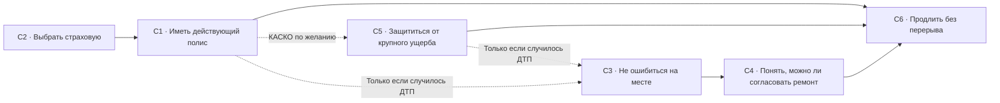

# Неделя 5 · Уровень 1 · Какие работы выполняет автострахование

**Курс Product Masters · Работы клиентов: часть 1 · 14 ноября 2026 года**

[Портфолио · 5.1](https://memodlike.github.io/portfolio-site/#w5-l1)

> C3 — самая важная работа по авторской оценке. Первой проверю C4: когда решение о выплате задерживается, человеку приходится решать, можно ли уже согласовать ремонт. Это можно проверить на конкретных обращениях.

Цифровой сервис автострахования в Казахстане: онлайн-полис ОГПО и КАСКО, продление, заявление об убытке и статус выплаты. Компания условная и обезличена.

**Гипотеза.** Важность и удовлетворённость — оценки автора до интервью. Шкала: 1 — почти неважно, 10 — критически важно. Полевых результатов пока нет.

## Шесть работ частного клиента

### C1 · Выехать с действующим полисом

Частный водитель, страхователь по ОГПО.

- **Когда:** срок ОГПО истекает завтра или я только что купил машину, а ехать в офис некогда.
- **Хочу:** иметь действующий полис до выезда, не тратя на это рабочий день.
- **Чтобы:** ехать законно и не получить штраф.
- **Важность 1–10:** 8, авторская оценка.
- **Решение:** оформление с телефона за несколько минут.
- **Триггер:** SMS о скором окончании полиса или покупка машины.
- **Сейчас:** агент у ЦОНа или приложение банка.

### C2 · Не остаться должным после ДТП

Страхователь по ОГПО: он выбирает страховую, но выплату по ОГПО получает потерпевший.

- **Когда:** выбираю страховую, а цена ОГПО у всех близкая.
- **Хочу:** быть уверенным, что пострадавшему заплатят без моего участия.
- **Чтобы:** ДТП по моей вине не превратилось в личный долг и споры.
- **Важность 1–10:** 7, авторская оценка.
- **Решение:** открытые сроки выплат и понятные отзывы о них.
- **Триггер:** рассказ знакомого о споре с выплатой.
- **Сейчас:** советы знакомых и отзывы в интернете.

### C3 · Не ошибиться в момент ДТП

Любой участник ДТП: виновник-страхователь, потерпевший или клиент с КАСКО.

- **Когда:** только что случилось ДТП: я на дороге, в стрессе, второй участник торопит.
- **Хочу:** понять, что сделать на месте, чтобы выплата состоялась.
- **Чтобы:** не потерять право на выплату из-за одной ошибки.
- **Важность 1–10:** 10, авторская оценка.
- **Решение:** пошаговая подсказка: что снять, что подписать, куда сообщить.
- **Триггер:** удар и первые минуты после остановки.
- **Сейчас:** звонок знакомому или агенту, поиск в интернете.

### C4 · Знать, когда можно ремонтировать

Наш страхователь по КАСКО, подавший заявление об убытке.

- **Когда:** я подал заявление по своему КАСКО, машина стоит, а сервис ждёт согласования ремонта.
- **Хочу:** понимать, когда и на какую сумму можно согласовать ремонт.
- **Чтобы:** не платить из своих и не оставаться без машины дольше нужного.
- **Важность 1–10:** 9, авторская оценка.
- **Решение:** статус дела, список недостающих документов и прогноз даты выплаты.
- **Триггер:** сервис назвал сумму ремонта, а решения по выплате нет.
- **Сейчас:** звонки в колл-центр, сообщения агенту.

### C5 · Не оплачивать крупный ремонт самому

Владелец новой или кредитной машины, клиент с КАСКО.

- **Когда:** машина новая или в кредите, и ремонт из своего кармана я не потяну.
- **Хочу:** чтобы крупный ущерб или угон не легли на семейный бюджет.
- **Чтобы:** одна авария не съела доход за год.
- **Важность 1–10:** 8, авторская оценка.
- **Решение:** КАСКО с понятными исключениями.
- **Триггер:** покупка новой машины или требование банка по кредиту.
- **Сейчас:** полис, который предложил банк или салон.

### C6 · Не остаться без защиты

Частный водитель, страхователь по ОГПО.

- **Когда:** полис заканчивается через две недели, я занят и не помню дату.
- **Хочу:** чтобы защита не прерывалась без моего внимания.
- **Чтобы:** не оказаться за рулём без полиса.
- **Важность 1–10:** 6, авторская оценка.
- **Решение:** продление в один шаг без повторного ввода данных.
- **Триггер:** напоминание за две недели до окончания.
- **Сейчас:** тот же агент, что и год назад.

## Четыре работы бизнес-клиента

### B1 · Ни одной машины без полиса

Руководитель автопарка, 20–200 машин; форма работы водителей не установлена.

- **Когда:** у машин парка разные даты окончания полисов, а учёт ведётся в Excel.
- **Хочу:** чтобы ни одна машина не вышла на линию с истёкшим полисом.
- **Чтобы:** не получать штрафы и не снимать машины с рейса.
- **Важность 1–10:** 9, авторская оценка.
- **Решение:** единый реестр полисов, напоминания и один счёт.
- **Триггер:** штраф или машина, снятая с линии из-за просроченного полиса.
- **Сейчас:** таблица Excel и знакомый агент.

### B2 · Знать, когда машина вернётся на линию

Руководитель автопарка после ДТП.

- **Когда:** машина после ДТП стоит, и каждый день простоя — недополученная выручка.
- **Хочу:** знать по каждой машине, когда она вернётся в работу.
- **Чтобы:** заранее подменить её и сократить простой.
- **Важность 1–10:** 9, авторская оценка.
- **Решение:** статус убытка и прогноз даты выплаты по каждой машине.
- **Триггер:** звонок водителя о ДТП.
- **Сейчас:** менеджер страховой в мессенджере, звонки.

### B3 · Закрыть период с полным комплектом

Бухгалтер компании.

- **Когда:** закрываю месяц или квартал, и нужны счета, акты и полисы по каждой машине.
- **Хочу:** иметь полный комплект документов к закрытию периода.
- **Чтобы:** не сверять вручную и не ждать ответа менеджера.
- **Важность 1–10:** 6, авторская оценка.
- **Решение:** документы в кабинете или через ЭДО.
- **Триггер:** закрытие месяца или запрос аудитора.
- **Сейчас:** письма менеджеру и сканы.

### B4 · Отдать клиенту машину застрахованной

Партнёр: автосалон, банк, лизинг.

- **Когда:** клиент подписывает договор купли-продажи или кредита и ждёт ключи.
- **Хочу:** чтобы клиент уехал застрахованным, а сделка не затянулась.
- **Чтобы:** закрыть сделку в один визит и получить комиссию.
- **Важность 1–10:** 8, авторская оценка.
- **Решение:** выпуск полиса в интерфейсе партнёра или по API.
- **Триггер:** клиент готов подписать договор.
- **Сейчас:** агент по телефону или отдельный портал страховой.

| Работа | Кто решает | Кто пользуется | Кто платит |
| :-- | :-- | :-- | :-- |
| B1 | Владелец или директор | Руководитель парка | Бухгалтерия компании |
| B2 | Руководитель парка | Водитель и механик | Компания: каждый день простоя |
| B3 | Главный бухгалтер | Бухгалтер | Компания |
| B4 | Руководитель салона или банка | Менеджер по продажам | Конечный клиент; партнёр получает комиссию |

## Граф работ

Большая работа: **Машина остаётся свободой и активом, а не источником внезапных расходов и проблем с законом**.

Основной путь — C2 → C1 → C6. КАСКО (C5) — необязательная ветка. ДТП — условная ветка C3 → C4. Продление возможно без КАСКО и без ДТП.

Для бизнеса большая работа — «автопарк зарабатывает каждый день, без простоев и штрафов»; к ней ведут B1 и B2.

Шаги внутри C3: от действий на месте до подачи заявления

1. Убедиться, что все целы, обозначить место ДТП.
2. Снять повреждения, номера и документы второго участника.
3. Сообщить страховой о случае.
4. Собрать пакет документов.
5. Подать заявление.
6. Показать машину на осмотр.

Индекс возможности и авторские оценки

**Гипотеза.** `I + max(I − S, 0)`, где I — важность, S — удовлетворённость; обе величины — оценки автора.

| Работа | I | S | Индекс |
| :-- | :-- | :-- | :-- |
| C3 · Не ошибиться в момент ДТП | 10 | 4 | 16 |
| C4 · Знать, когда можно ремонтировать | 9 | 3 | 15 |
| B2 · Знать, когда машина вернётся на линию | 9 | 4 | 14 |
| B1 · Ни одной машины без полиса | 9 | 5 | 13 |
| B4 · Отдать клиенту машину застрахованной | 8 | 5 | 11 |
| C2 · Не остаться должным после ДТП | 7 | 4 | 10 |
| C5 · Не оплачивать крупный ремонт самому | 8 | 6 | 10 |
| C1 · Выехать с действующим полисом | 8 | 8 | 8 |
| B3 · Закрыть период с полным комплектом | 6 | 5 | 7 |
| C6 · Не остаться без защиты | 6 | 7 | 6 |

C3 = 16, C4 = 15. C6: `6 + max(6 − 7, 0) = 6`. Разница C3 и C4 не измеряет предпочтения клиентов; приоритет C4 нужно проверить по конкретным обращениям.

Сценарий нагрузки и валовой премии

**Сценарный расчёт.** Все входные числа — допущения для одной месячной когорты.

`625 × 0,65 × 3 × 5 / 60 = 101,56` операторского часа: 625 дел, 65% с повторным вопросом, 3 обращения по 5 минут. Это нагрузка, а не экономия. Устранимые затраты = реально высвобожденные часы × устранимая стоимость часа; обе величины неизвестны.

Изменение валовой премии = **число подходящих уникальных страхователей × предполагаемое изменение вероятности продления × ₸35 000**.

Только если все 625 — разные наши клиенты с наступающим продлением: 10 п.п. дают `625 × 0,10 × ₸35 000 = ₸2 187 500`, около **₸2,19 млн** валовой премии; 5–15 п.п. — **₸1,09–3,28 млн**. Потерпевший по ОГПО виновника — отдельная сторона; заявитель по чужому полису в число наших продлевающих клиентов не входит.

Валовая премия не равна марже. Ценность продлений относительно сокращения звонков пока не установлена: нужны устранимые затраты и маржа, а не только объём премии.

## Что проверю дальше

**План.** Первая метрика — повторные обращения за статусом / подходящие дела, где нужно решить вопрос о ремонте. Позже — продление среди уникальных наших клиентов, которым наступил срок продлевать, с учётом изменения цены.

| Работа | С кем говорю | Вопросы о последнем реальном случае |
| :-- | :-- | :-- |
| C4 | Люди, которые недавно подавали заявление и ждали выплату | Про последний реальный случай: какой информации не хватало, что они делали, какое решение пришлось отложить |
| C1, C6 | Водители без убытков | Как прошли последняя покупка и последнее продление, что мешало |
| B2 | Руководители автопарков | Последняя машина после ДТП: сколько стояла и от чего зависел срок |

Снижу приоритет C4, если статус уже был понятен, а решение задерживалось по другой причине — например, не было свободного места в ремонте. Рассказы о последнем реальном случае должны показать, какое решение отложили, какой информации не хватало и что сделали дальше.

Репетиция интервью: ответы смоделированы

Это придуманные ответы для проверки гайда, а не запись интервью и не доказательство.

| Вопрос | Смоделированный ответ |
| :-- | :-- |
| Все контексты | После ДТП; когда приходит напоминание о продлении; когда покупаю машину. |
| Основные работы | Иметь действующий полис, знать, когда можно ремонтировать, не остаться без защиты. |
| Какую основную работу изучаем | Знать, когда можно ремонтировать. |
| Контекст результата | Я страхователь по КАСКО этой компании. Заявление подано 6 дней назад, машина на стоянке, в сервисе просят согласовать ремонт. |
| Триггер | Сервис назвал сумму ремонта, а решения по выплате нет. |
| Большая работа | Вернуться к обычной жизни: возить детей и ездить на работу на своей машине. |
| Эмоции в точке Б | Спокойствие и контроль: я знаю дату и сумму. |
| Эмоции в точке А | Тревога и злость: кажется, что про меня забыли. |
| Частотность | 3–4 обращения за статусом на одно дело. |
| Важность | 9 из 10. |
| Польза и ценность | Понимаю, можно ли уже согласовать ремонт и какие расходы придётся покрыть самому. |
| Шаги работы | Позвонил в колл-центр → ждал на линии → назвал номер дела → услышал «в работе» → через три дня позвонил снова. |

[Продолжение · уровень 2](../Week5_medium_AJTBD_Segments/)
