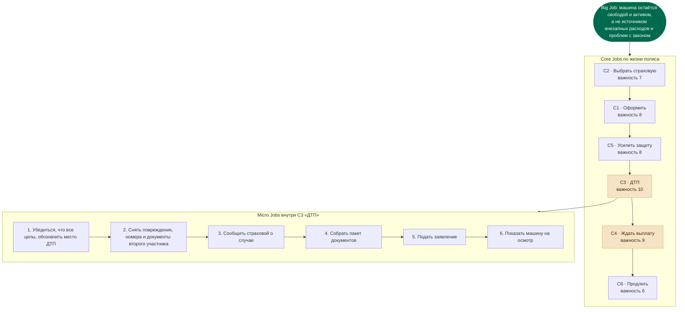

# Неделя 5 · Уровень 1 · Какие работы выполняет автострахование

**Курс Product Masters «Mid to Senior Product Manager (AI-Powered)» · Jobs-to-be-Done in Action Part 1 · 14 ноября 2026 года**

Оформленная версия с графом и диаграммами: **[https://memodlike.github.io/portfolio-site/#w5-l1](https://memodlike.github.io/portfolio-site/#w5-l1)**

## Короткий ответ

**Продукт.** Цифровой сервис автострахования в Казахстане: онлайн-полис ОГПО и КАСКО, продление, заявление об убытке и трекинг статуса выплаты (Claim Status Assistant).

Описано **10 работ: 6 B2C и 4 B2B**, каждая в формате «Когда → Хочу → Чтобы → Важность».

> **Главный вывод.** Полис покупают ради одной работы, а продлевают или уходят из-за другой. Оформление занимает пять минут раз в год. Убыток случается редко, но длится неделями, и именно он решает, останется ли клиент.

| Что | Результат |
| :-- | :-- |
| Самая важная работа | **C3 «Не ошибиться в момент ДТП»**, важность 10 из 10 |
| Наибольший разрыв | **C3**, индекс возможности 16 из 20 |
| Где продукт уже хорош | Оформление и продление (C1, C6) |
| Что это меняет | Сценарий «Случилось ДТП» на первый экран, статус выплаты как отдельный продукт |

> Оценки важности, удовлетворённости и среднего чека — мои рабочие гипотезы для приоритизации, а не данные компании. Полевые интервью — следующий шаг, поэтому каждая оценка записана так, чтобы её можно было опровергнуть.

---

## Основное задание

### 1. Работы частного клиента (B2C)

| № | Кто | Когда | Хочу | Чтобы | Важность |
| :-- | :-- | :-- | :-- | :-- | :-: |
| **C1** · Оформить полис и выехать | Частный водитель | Срок ОГПО истекает завтра или я только что купил машину, а ехать в офис некогда | **Оформить полис с телефона за несколько минут** | Законно выехать уже сегодня и не получить штраф | **8** |
| **C2** · Понять, кто реально заплатит | Частный водитель | Выбираю страховую, а цена ОГПО у всех почти одинаковая | **Понять, кто платит быстро и без споров** | После ДТП не остаться один на один с ремонтом | **7** |
| **C3** · Не ошибиться в момент ДТП | Частный водитель | Только что случилось ДТП: я на дороге, в стрессе, второй участник торопит | **Получить пошаговую подсказку: что снять, что подписать, куда сообщить** | Не потерять право на выплату из-за одной ошибки | **10** |
| **C4** · Знать, что с моей выплатой | Частный водитель | Заявление подано, машина стоит, прошла неделя тишины | **Видеть этап, каких документов не хватает и когда ждать деньги** | Спланировать ремонт и бюджет, а не обзванивать колл-центр | **9** |
| **C5** · Защитить дорогую машину | Владелец новой или кредитной машины | Машина новая или в кредите, и ремонт из своего кармана я не потяну | **Застраховать крупный ущерб по КАСКО с понятными исключениями** | Одна авария не съела семейный бюджет на год | **8** |
| **C6** · Продлить и забыть | Частный водитель | Полис заканчивается через две недели, я занят и не помню дату | **Продлить в один тап, без повторного ввода данных** | Защита не прервалась и об этом не пришлось думать | **6** |

### 2. Работы бизнес-клиента (B2B)

В B2B важность задаёт не человек, а экономика: день простоя машины или сорванная сделка имеют цену.

| № | Кто | Когда | Хочу | Чтобы | Важность |
| :-- | :-- | :-- | :-- | :-- | :-: |
| **B1** · Ни одной машины без полиса | Руководитель автопарка, 20–200 машин | У машин парка разные даты окончания полисов, а учёт ведётся в Excel | **Единый реестр полисов с автопродлением и одним счётом** | Ни одна машина не встала из-за штрафа или просроченного полиса | **9** |
| **B2** · Вернуть машину в работу | Руководитель автопарка после ДТП | Машина после ДТП стоит, и каждый день простоя — недополученная выручка | **Быстрое урегулирование и прогноз даты выплаты по каждому делу** | Сократить простой и заранее подменить машину на линии | **9** |
| **B3** · Закрыть период без переписки | Бухгалтер компании | Закрываю месяц или квартал, и нужны счета, акты и полисы по каждой машине | **Получить закрывающие документы в кабинете или через ЭДО** | Закрыть период без ручной сверки и запросов менеджеру | **6** |
| **B4** · Не сорвать сделку из-за полиса | Партнёр: автосалон, банк, лизинг | Клиент подписывает договор купли-продажи или кредита и ждёт ключи | **Выпустить полис за пару минут в своём интерфейсе или по API** | Закрыть сделку в один визит и заработать комиссию | **8** |

Шкала важности — из задания: 1 почти неважно, 10 критически важно.

---

## Сверх задания

### 3. Граф работ

Все шесть работ частного клиента служат одной большой работе. Самая важная из них распадается на шесть шагов.

Работы с важностью 9–10 (выделены) стоят после покупки: продукт зарабатывает доверие там, где клиент уже заплатил. У бизнеса большая работа другая: «автопарк зарабатывает каждый день, без простоев и штрафов», и работы B1–B2 ведут к ней напрямую.

### 4. Где продукт недорабатывает

Важность сама по себе не говорит, куда вкладываться: важная работа может быть уже хорошо закрыта. Поэтому к каждой работе добавлена оценка удовлетворённости и посчитан индекс возможности:

`индекс = важность + max(важность − удовлетворённость, 0)`

| Работа | Важность | Удовлетворённость | Индекс |
| :-- | :-: | :-: | :-: |
| C3 · Не ошибиться в момент ДТП | 10 | 4 | **16** |
| C4 · Знать, что с моей выплатой | 9 | 3 | **15** |
| B2 · Вернуть машину в работу | 9 | 4 | **14** |
| B1 · Ни одной машины без полиса | 9 | 5 | **13** |
| B4 · Не сорвать сделку из-за полиса | 8 | 5 | **11** |
| C2 · Понять, кто реально заплатит | 7 | 4 | **10** |
| C5 · Защитить дорогую машину | 8 | 6 | **10** |
| C1 · Оформить полис и выехать | 8 | 8 | **8** |
| B3 · Закрыть период без переписки | 6 | 5 | **7** |
| C6 · Продлить и забыть | 6 | 7 | **6** |

Четыре верхние строки — работы после ДТП и работы автопарка. Оформление и продление внизу: там клиенту уже удобно, и новые функции почти ничего не добавят.

### 5. Что это меняет в продукте

| Решение | Почему | Метрика |
| :-- | :-- | :-- |
| **Сценарий «Случилось ДТП» — на первый экран** | Работа C3 важна на 10, а продукт сегодня встречает клиента витриной полисов. Один тап открывает чек-лист, камеру и заявление. | Доля заявлений с полным пакетом документов с первого раза |
| **Статус выплаты — отдельный продукт, а не строка в кабинете** | Работы C4 и B2 — второй и третий разрыв. Этап, недостающие документы и прогноз даты закрывают их одной механикой. | Повторные обращения на одно дело; продление после убытка |
| **Оформление не улучшать, а не ломать** | C1 и C6 уже закрыты хорошо. Здесь выигрыш не в новых функциях, а в автопродлении и отсутствии шагов. | Доля продлений без участия оператора |

### 6. Как я это проверю

Всё выше — гипотезы. Чтобы они не остались мнением, я прогнал шаблон интервью курса на самой спорной работе.

<b>Пробный прогон шаблона интервью: работа C4 «Знать, что с моей выплатой»</b>

Ответы смоделированы по типовым обращениям клиентов. Это проверка гайда перед полевыми интервью, а не запись реального разговора.

| Вопрос шаблона | Ответ |
| :-- | :-- |
| 1. Все контексты | После ДТП; когда приходит напоминание о продлении; когда покупаю машину. |
| 2. Core Jobs | Оформить полис, понять статус выплаты, продлить без визита. |
| 3. Какую Core Job изучаем | Знать, что с моей выплатой. |
| 4. Контекст результата | Заявление подано 6 дней назад, машина на стоянке, в сервисе просят предоплату. |
| 5. Триггер | Сервис назвал сумму ремонта, а я не знаю, одобрена ли выплата. |
| 6. Big Job | Вернуться к обычной жизни: возить детей и ездить на работу на своей машине. |
| 7. Эмоции в точке Б | Спокойствие и контроль: я знаю дату и сумму. |
| 8. Эмоции в точке А | Тревога и злость: кажется, что про меня забыли. |
| 9. Частотность | 3–4 обращения за статусом на одно дело. |
| 10. Важность | 9 из 10. |
| 11. Польза и ценность | Вижу этап сам, без звонка. У конкурентов статус узнаётся только по телефону. |
| 12. Micro Jobs | Позвонил в колл-центр → ждал на линии → назвал номер дела → услышал «в работе» → через три дня позвонил снова. |

**Где я могу ошибаться**

- Важность оценена мной по логике ситуации, а не клиентами. Интервью могут переставить работы местами.
- Удовлетворённость не измерена. Это оценка по типовым обращениям, её заменит опрос после интервью.
- В B2B одну работу выполняют три роли: кто решает, кто пользуется, кто платит. На уровне 3 я разделю их.

**Следующий шаг.** Восемь интервью по шаблону: четыре клиента с убытком за последние полгода, два без убытка, два руководителя автопарков. Если хотя бы пять из восьми не назовут статус выплаты проблемой, решение 2 снимается.

---

Продолжение: [Уровень 2 · Пять новых сегментов](../Week5_medium_AJTBD_Segments/)
